# Questions for Dallas 311 and service departments

This is a working list of **unanswered** questions raised by the saved Dallas 311 inventory in `data/311`. The questions describe what was saved from the website. City staff have not yet confirmed whether that content reflects current City policy. For each question, ask staff to confirm the rule, the wording residents should see, and the team responsible for any website correction. Record the answer, contact, and date in the table below before changing instructions about where to report a problem.

The possible answers below are inferred from the saved content and have not been confirmed by City staff. Staff may choose an option, combine parts of several options, or use “Other” to explain the correct answer. For questions with several parts, please also address any details the options do not cover.

The screenshots below were captured from the live Dallas 311 portal on October 17, 2026. Red marks in the Word export point to the text or choices being discussed. Live recheck notes identify changes or saved observations that could not be reproduced. The screenshots show website behavior, not a confirmed City rule.

---

## ROUTING CONFLICTS

A reporting route is the service, form, or phone number a resident uses to ask for help. Common examples of reporting routes include calling 311, submitting an online service request, or using a separate complaint form linked from a City page. These routes conflict when one page tells a resident to use a service, but another page says that service does not cover the problem or gives different instructions. The questions below ask staff to explain which instructions residents should follow.

### 1. Alley ruts off the pavement.

The “Alley Repair - Routine” and “Alley/Sidewalk/Street Repair - Hazardous” forms tell residents to use “Sanitation Property Damage” for ruts in dirt off the pavement. But “Sanitation Property Damage” says it covers damage only when Sanitation trucks caused it.

Where should residents report ruts in a dirt alley if another vehicle, erosion, or an unknown cause created them? Should residents use a different service if a rut is dangerous?

**POSSIBLE ANSWERS**:
**A.** Use “Alley Repair - Routine” for ruts not caused by Sanitation trucks; call 311 if the rut is dangerous.
**B.** Use “Sanitation Property Damage” for all dirt-alley ruts; its description needs to explain this broader coverage.
**C.** Call 311 so staff can identify who caused the damage and choose the responsible service.
**D.** Other: _____________

**EVIDENCE:**
- [Alley Repair - Routine](311/alley-repair-routine.json)
- [Alley/Sidewalk/Street Repair - Hazardous](311/alley-sidewalk-street-repair-hazardous.json)
- [Sanitation Property Damage](311/sanitation-property-damage.json)

**SCREENSHOT EVIDENCE:**

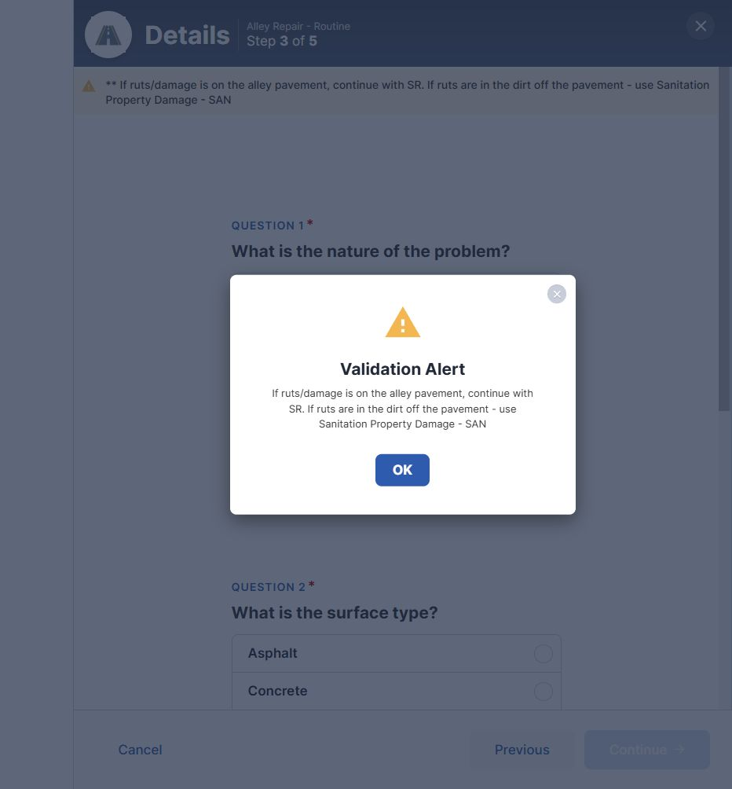

**Figure 1.** “Alley Repair - Routine” sends dirt ruts to “Sanitation Property Damage - SAN”. [Dallas 311](https://dallascrm.my.site.com/public/s/), captured October 17, 2026.

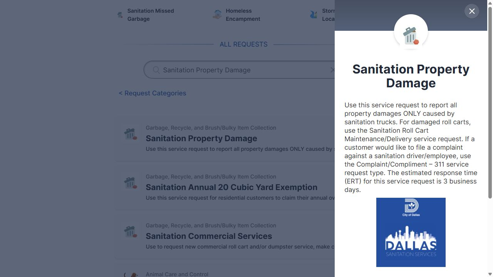

**Figure 2.** “Sanitation Property Damage” limits coverage to damage caused by Sanitation trucks. [Dallas 311](https://dallascrm.my.site.com/public/s/), captured October 17, 2026.

### 2. Obstructed traffic signs and signals.

“Visibility Obstruction” says to call 311 when something blocks the view of a traffic sign or signal. “Traffic Sign - Visibility Obstruction” says its phone service covers only stop, yield, and one-way signs. It tells residents to use “Traffic Sign Maintenance (Other)” for other signs.

Which service should residents use when vegetation or another object blocks the view of each of the following?
- A stop, yield, or one-way sign
- Another type of traffic sign
- A traffic signal

**POSSIBLE ANSWERS**:
**A.** Call 311 for all blocked signs and signals; staff choose the service.
**B.** Call 311 for blocked stop, yield, and one-way signs and for blocked signals; use “Traffic Sign Maintenance (Other)” for other signs.
**C.** Use “Visibility Obstruction” for vegetation or objects blocking the view; use the sign services for problems with the signs themselves.
**D.** Other: _____________

**EVIDENCE:**
- [Visibility Obstruction](311/visibility-obstruction.json)
- [Traffic Sign - Visibility Obstruction](311/traffic-sign-visibility-obstruction.json)
- [Traffic Sign Maintenance (Other)](311/traffic-sign-maintenance-other.json)

**SCREENSHOT EVIDENCE:**

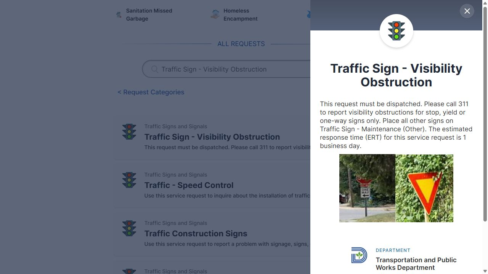

**Figure 3.** The sign service limits its phone route to stop, yield, and one-way signs. [Dallas 311](https://dallascrm.my.site.com/public/s/), captured October 17, 2026.

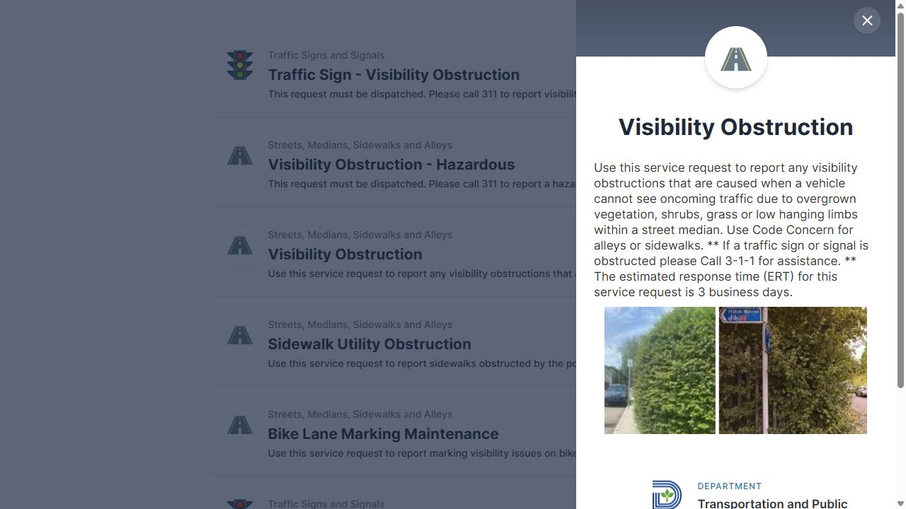

**Figure 4.** The general service says to call 311 for an obstructed sign or signal. [Dallas 311](https://dallascrm.my.site.com/public/s/), captured October 17, 2026.

### 3. Hazardous utility cuts that are not square.

“Utility Street Cuts - Hazardous” says to call 311. It also tells residents to use “Street Repair - Routine” for cuts that are not square. However, the saved “Street Repair” form tells residents to call 311 if they say the repair is hazardous.

Should residents call 311 for every hazardous utility cut, whatever its shape? If so, should the “Utility Street Cuts - Hazardous” page stop directing residents to the routine service?

**POSSIBLE ANSWERS**:
**A.** Call 311 for every hazardous utility cut, regardless of shape; remove the instruction to use the routine service.
**B.** Use “Street Repair” for cuts that are not square, even if hazardous; update that form so it accepts those reports.
**C.** Keep the services separate by shape, but have 311 staff choose the correct service for all hazardous reports.
**D.** Other: _____________

**EVIDENCE:**
- [Utility Street Cuts - Hazardous](311/utility-street-cuts-hazardous.json)
- [Street Repair](311/street-repair.json)

**SCREENSHOT EVIDENCE:**

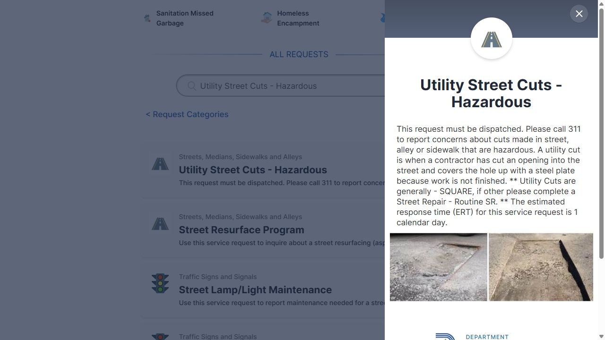

**Figure 5.** The hazardous utility-cut service names a routine service for cuts of other shapes. [Dallas 311](https://dallascrm.my.site.com/public/s/), captured October 17, 2026.

### 4. Debris on freeways.

“Street Spillage/Debris in Right of Way” says TxDOT is responsible for freeways. Yet its Dallas 311 form includes “Freeway” as a location choice and asks which lane is blocked.

Where should residents report dangerous debris in a freeway travel lane: to TxDOT, through this Dallas 311 form, or through another urgent reporting service? Who handles debris in the grassy area beside a freeway?

**POSSIBLE ANSWERS**:
**A.** Report both travel-lane debris and debris beside freeways to TxDOT; remove the Dallas 311 form choice if it is not used.
**B.** Submit freeway debris through Dallas 311; City staff send the report to TxDOT.
**C.** Use a separate urgent reporting process for dangerous debris in travel lanes and TxDOT for debris in grassy areas; staff must provide the exact process.
**D.** Other: _____________

**EVIDENCE:**
- [Street Spillage/Debris in Right of Way](311/street-spillage-debris-in-right-of-way.json)
- [Median/Right of Way Maintenance](311/median-right-of-way-maintenance.json)

**SCREENSHOT EVIDENCE:**

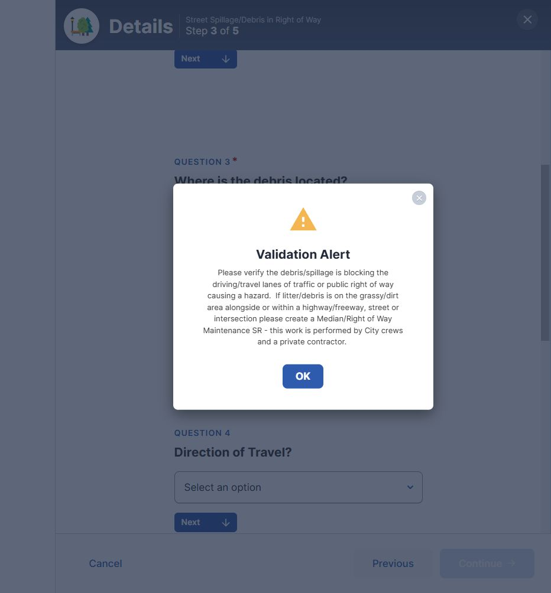

**Figure 6.** After “Freeway” is selected, the debris form discusses travel-lane hazards and refers grassy-area debris to “Median/Right of Way Maintenance”. [Dallas 311](https://dallascrm.my.site.com/public/s/), captured October 17, 2026.

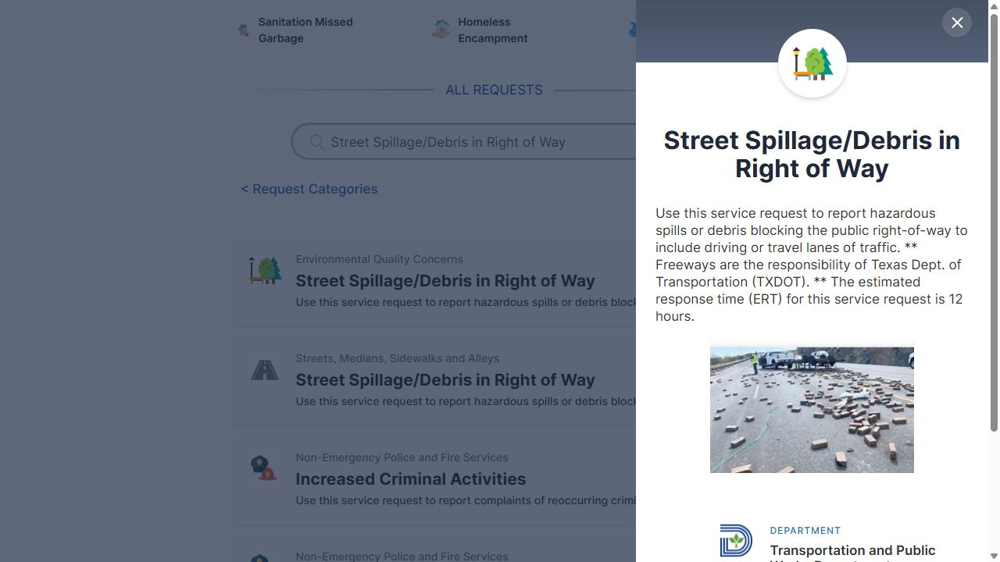

**Figure 7.** The debris service assigns freeway responsibility to TxDOT. [Dallas 311](https://dallascrm.my.site.com/public/s/), captured October 17, 2026.

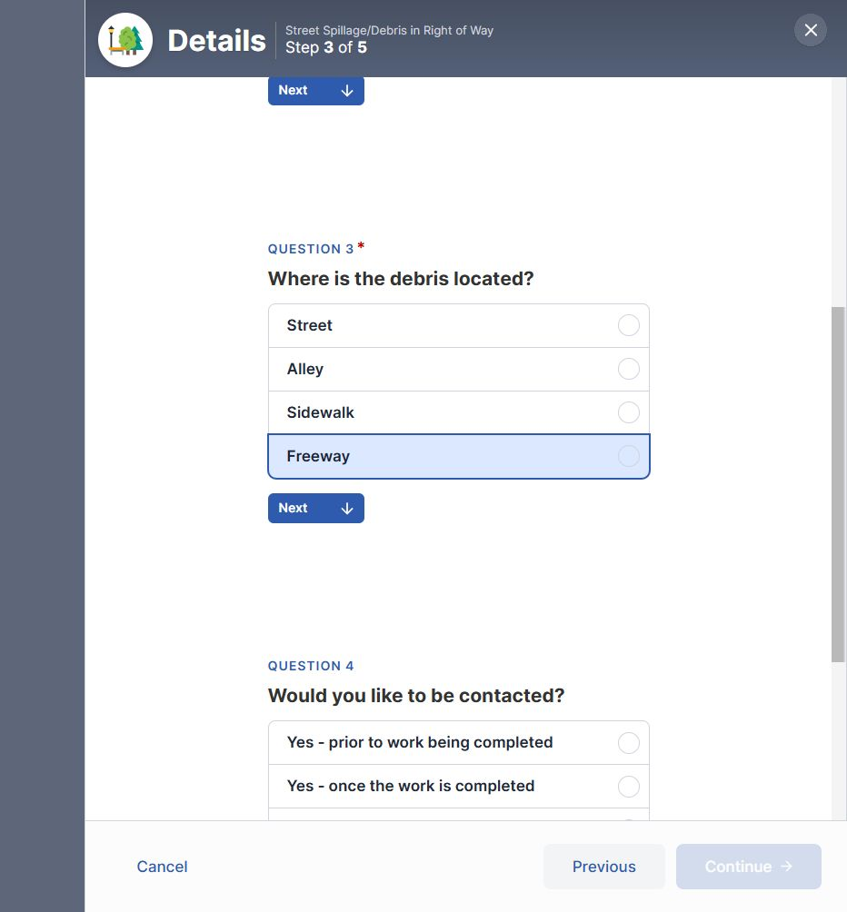

**Figure 8.** The Dallas 311 debris form offers “Freeway” as a debris location. [Dallas 311](https://dallascrm.my.site.com/public/s/), captured October 17, 2026.

### 5. Police oversight submissions.

The “File a Complaint or Commendation – Community Police Oversight” service has no “Request This Service” button. Its saved text points to separate complaint and commendation forms and says to call 311 for more information.

Are the separate forms the correct way to submit a complaint or commendation? Does 311 only provide information, or can staff also take a submission by phone? Should the City list this page as guidance rather than as a service request?

**POSSIBLE ANSWERS**:
**A.** Use the separate complaint and commendation forms; 311 provides information only. List the City page as guidance.
**B.** Use either the separate forms or 311 by phone; staff can take submissions through both.
**C.** Use the separate forms to submit; 311 helps residents reach the correct form or office but does not take submissions.
**D.** Other: _____________

**EVIDENCE:**
- [File a Complaint or Commendation – Community Police Oversight](311/file-a-complaint-or-commendation-community-police-oversight.json)

**SCREENSHOT EVIDENCE:**

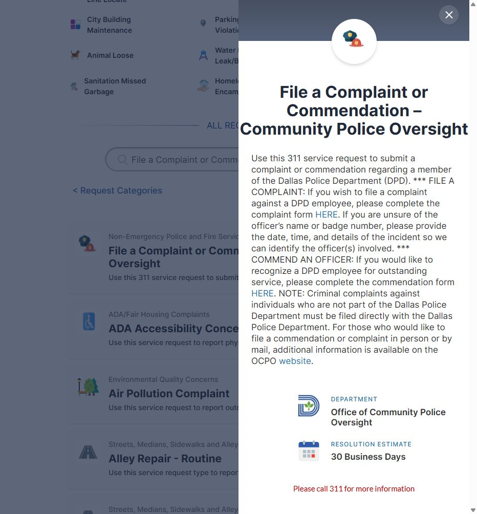

**Figure 9.** The oversight panel ends with “Please call 311 for more information” rather than an online request button. [Dallas 311](https://dallascrm.my.site.com/public/s/), captured October 17, 2026.

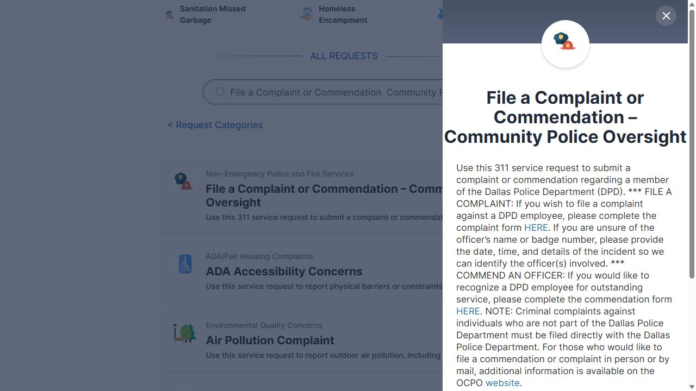

**Figure 10.** The oversight description links to separate complaint and commendation forms. [Dallas 311](https://dallascrm.my.site.com/public/s/), captured October 17, 2026.

---

## SERVICE NAMES AND COVERAGE

Some pages tell residents to use a service name that does not appear in the saved public portal. Other names are similar enough that it is hard to tell whether they refer to the same service. These questions ask staff to confirm the correct public names and explain which problems each service covers.

### 6. Guardrail maintenance name.

“Guardrail New” tells residents to use “Guardrail Repair - Routine” for maintenance. The saved public service is named “Guardrail Maintenance”.

Do both names refer to the same service? Which name should residents see in the instructions? Is there a separate routine repair service that is missing from the public portal?

**POSSIBLE ANSWERS**:
**A.** Both names refer to the same service; use “Guardrail Maintenance” in public instructions.
**B.** The names refer to separate services; add or restore the public listing for “Guardrail Repair - Routine”.
**C.** “Guardrail Repair - Routine” is an old name; update “Guardrail New” to point to the current service.
**D.** Other: _____________

**EVIDENCE:**
- [Guardrail New](311/guardrail-new.json)
- [Guardrail Maintenance](311/guardrail-maintenance.json)

**SCREENSHOT EVIDENCE:**

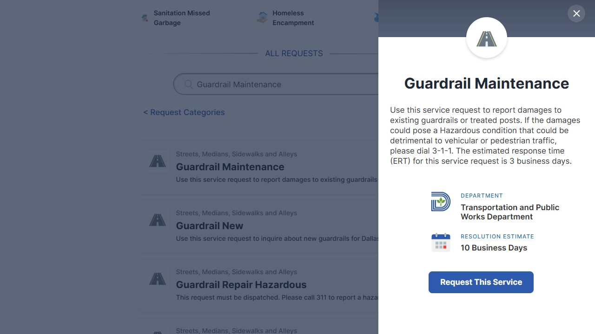

**Figure 11.** The public service title is “Guardrail Maintenance”. [Dallas 311](https://dallascrm.my.site.com/public/s/), captured October 17, 2026.

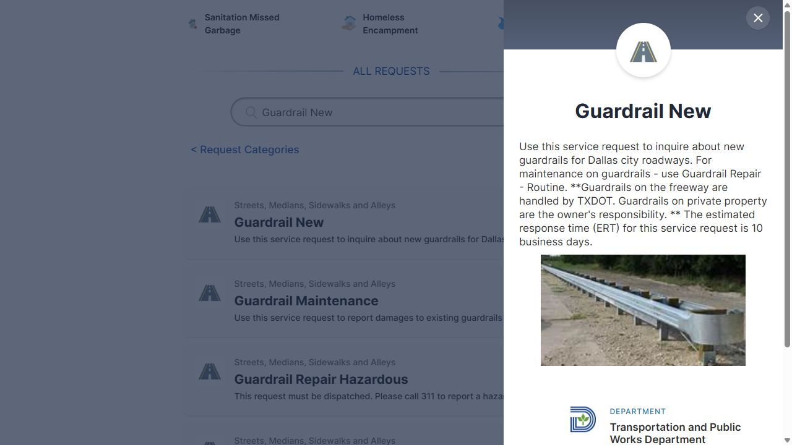

**Figure 12.** “Guardrail New” refers maintenance to “Guardrail Repair - Routine”. [Dallas 311](https://dallascrm.my.site.com/public/s/), captured October 17, 2026.

### 7. Noisy animals.

“Noise Complaint (Residential)” tells residents to use “Animal - Noisy” for noise from animals. No saved public service has that name.

Should residents use “Animal Nuisance”, “Animal Community Cat Nuisance”, another service, or call 311? Does the correct choice depend on the type of animal or whether the noise is happening now?

**POSSIBLE ANSWERS**:
**A.** Use “Animal Nuisance” for animal noise; replace the “Animal - Noisy” reference.
**B.** Use “Animal Community Cat Nuisance” for community cats and “Animal Nuisance” for other animals.
**C.** Call 311 so staff can choose a service based on the animal and whether the noise is happening now.
**D.** Other: _____________

**EVIDENCE:**
- [Noise Complaint (Residential)](311/noise-complaint-residential.json)
- [Animal Nuisance](311/animal-nuisance.json)
- [Animal Community Cat Nuisance](311/animal-community-cat-nuisance.json)

**SCREENSHOT EVIDENCE:**

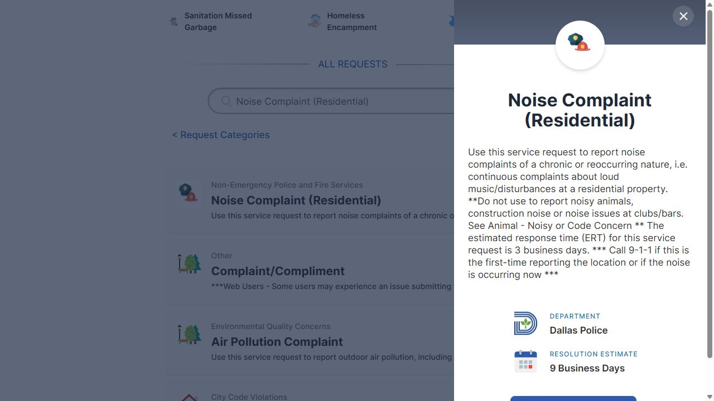

**Figure 13.** The residential noise description refers animal concerns to “Animal - Noisy”. [Dallas 311](https://dallascrm.my.site.com/public/s/), captured October 17, 2026.

### 8. Community cat program name.

The “Animal Loose” form tells residents to use “Animal Community Cat Program - DAS” for loose, healthy cats. The saved portal instead has separate services named “Animal Community Cat Nuisance” and “Animal Community Cat Spay/Neuter Services”.

Which service should residents use if they want a healthy loose cat picked up, need help with the cat, or only want to report seeing it? Does “Animal Community Cat Program - DAS” refer to an old service name or a name used only by staff?

**Live recheck — October 17, 2026:** The live form showed the “Cat” choice, but the saved alert naming “Animal Community Cat Program - DAS” did not appear during this capture. Staff still need to confirm the correct service.

**POSSIBLE ANSWERS**:
**A.** “Animal Community Cat Program - DAS” is an old or internal name; use “Animal Community Cat Nuisance” for concerns and “Animal Community Cat Spay/Neuter Services” for spay/neuter help.
**B.** Call 311 for pickup requests or general help; the two public forms serve narrower purposes.
**C.** A healthy loose cat does not qualify for routine pickup, and a sighting alone does not need a request; staff should explain when either public service applies.
**D.** Other: _____________

**EVIDENCE:**
- [Animal Loose](311/animal-loose.json)
- [Animal Community Cat Nuisance](311/animal-community-cat-nuisance.json)
- [Animal Community Cat Spay/Neuter Services](311/animal-community-cat-spay-neuter-services.json)

**SCREENSHOT EVIDENCE:**

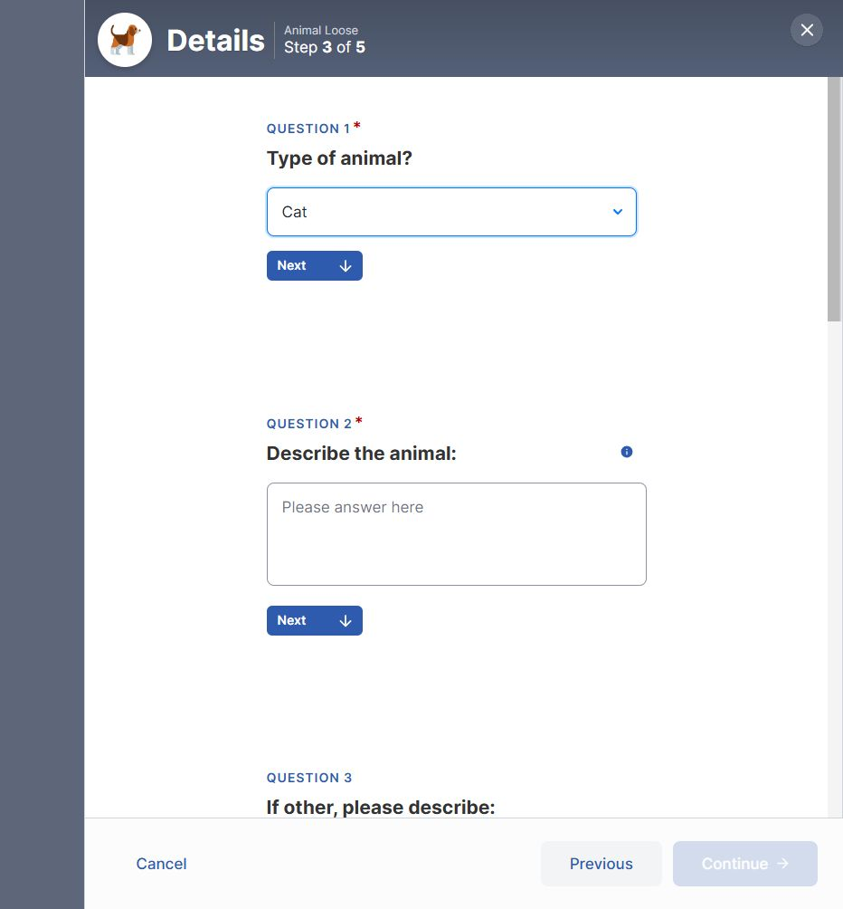

**Figure 14.** Live recheck: “Animal Loose” accepts “Cat”; the saved “Animal Community Cat Program - DAS” alert was not reproduced in this capture. [Dallas 311](https://dallascrm.my.site.com/public/s/), captured October 17, 2026.

### 9. Matching other service names.

Several pages refer residents to service names that differ from the names in the saved public portal. Do the following pairs refer to the same services?

| Name used in referral instructions on another service page | Service title in the saved public portal |
|---|---|
| Street Lighting - Maintenance | Street Lamp/Light Maintenance |
| Traffic Sign - Maintenance (Other) | Traffic Sign Maintenance (Other) |
| Extra Patrol - DPD | Increased Police Patrol |
| Housing & Neighborhood Revitalization Requests | Housing & Neighborhood Revitalization |

Are the names in the left column old names or names used only by staff? Please provide a City-approved list that matches each old or internal name to its current public name. That list would help ensure that instructions use the exact names residents can find.

**POSSIBLE ANSWERS**:
**A.** All four pairs refer to the same services; replace each name in the left column with the public title in the right column.
**B.** Only some pairs refer to the same services; staff should mark each match and explain any difference in coverage.
**C.** The names in the left column are separate internal services that 311 staff can select; public instructions should explain how residents reach them.
**D.** Other: _____________

**EVIDENCE:**
- [Utility Complaint/Information](311/utility-complaint-information.json)
- [Traffic Sign - Visibility Obstruction](311/traffic-sign-visibility-obstruction.json)
- [Traffic - Speed Control](311/traffic-speed-control.json)
- [Social Services Request](311/social-services-request.json)

**SCREENSHOT EVIDENCE:**

**Figure 15.** The visibility page uses the referral name “Traffic Sign - Maintenance (Other)”. [Dallas 311](https://dallascrm.my.site.com/public/s/), captured October 17, 2026.

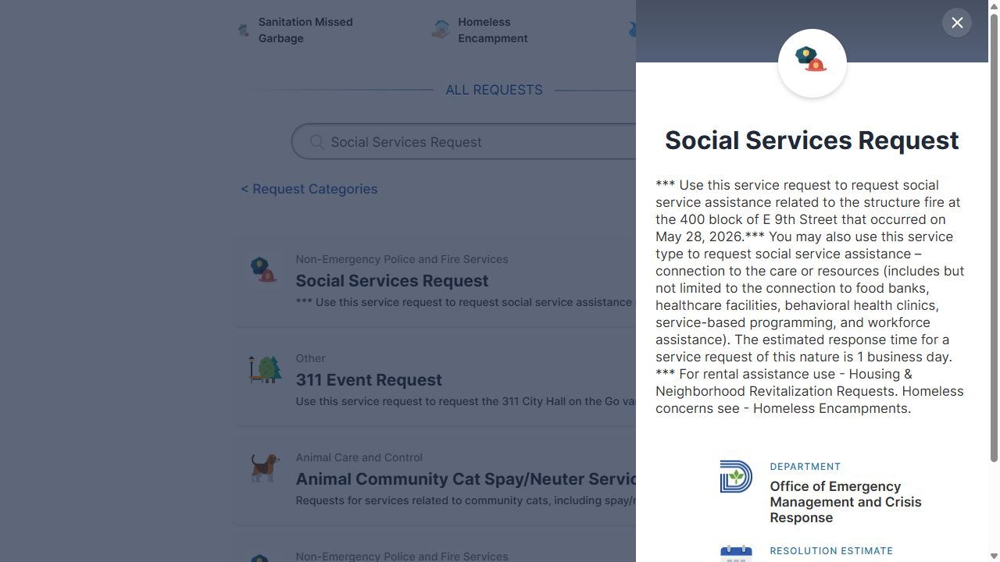

**Figure 16.** The social-services page uses “Housing & Neighborhood Revitalization Requests”. [Dallas 311](https://dallascrm.my.site.com/public/s/), captured October 17, 2026.

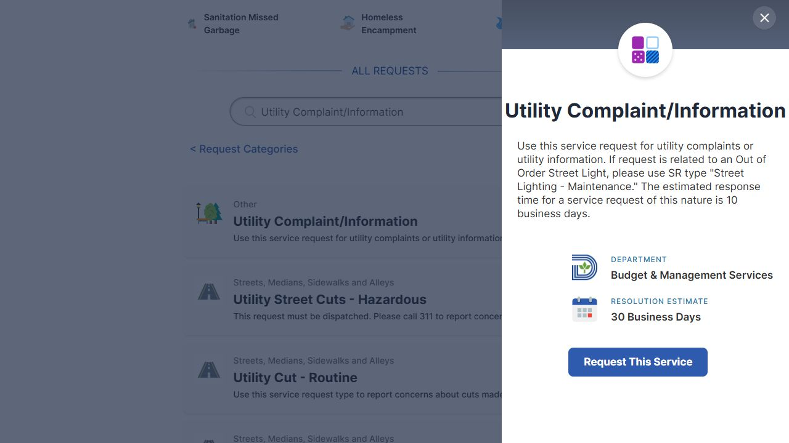

**Figure 17.** The utility information page uses the referral name “Street Lighting - Maintenance”. [Dallas 311](https://dallascrm.my.site.com/public/s/), captured October 17, 2026.

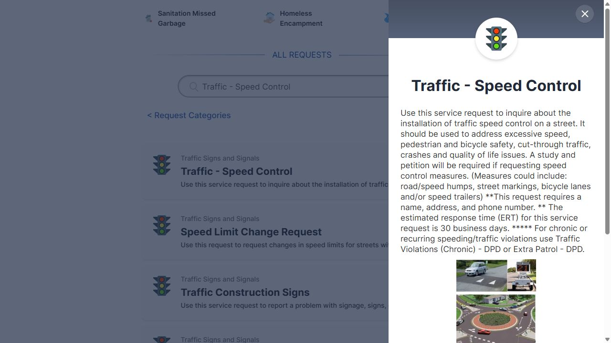

**Figure 18.** The speed-control page uses the referral name “Extra Patrol - DPD”. [Dallas 311](https://dallascrm.my.site.com/public/s/), captured October 17, 2026.

---

## TIMELINES, ACCESS, AND MISSING DESTINATIONS

These questions concern details that can leave residents unsure what to expect or how to finish a request. A description may give a different wait time or fee than the form, a needed link may be missing, or a form may offer a choice that its description seems to rule out. Other questions ask whether residents should call or submit a form, and what information they must provide.

### 10. Two response-time values.

Many service descriptions give an estimated response time that differs from the saved `resolutionEstimate` field. In each example below, the description gives the first value and the field gives the second:

- “311 Event Request”: **2 business days** and **5 business days**
- “ADA Accessibility Concerns”: **5** and **30**
- “Sanitation Property Damage”: **3** and **10**

Do these values measure different things, such as the time until the City first responds and the time until it finishes the work? Which value should residents see? Please define “response”, “resolution”, “business days”, “calendar days”, and “hours” as used in these estimates.

A simple text comparison found different numbers in 127 of the 178 saved records. A person needs to review that count because the comparison did not account for differences in units or wording.

**POSSIBLE ANSWERS**:
**A.** The description measures the time to first response, while “resolutionEstimate” measures the time to finish the work; show both with clear labels.
**B.** Both values are meant to measure the same thing, but the descriptions are outdated; use the current “resolutionEstimate” values.
**C.** Both values are meant to measure the same thing, but the saved field is outdated; use the current description values.
**D.** The meaning varies by service; each department must confirm the time, unit, and event that starts and ends the clock.
**E.** Other: _____________

**EVIDENCE:**
- [311 Event Request](311/311-event-request.json)
- [ADA Accessibility Concerns](311/ada-accessibility-concerns.json)
- [Sanitation Property Damage](311/sanitation-property-damage.json)

**SCREENSHOT EVIDENCE:**

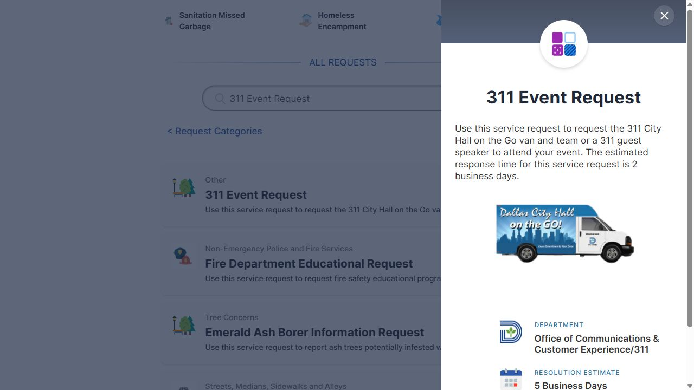

**Figure 19.** The same live panel shows “2 business days” in its description and “5 Business Days” under “RESOLUTION ESTIMATE”. [Dallas 311](https://dallascrm.my.site.com/public/s/), captured October 17, 2026.

### 11. Missing “Click Here” destinations.

Several saved descriptions tell residents to follow a link, but the link’s web address was not captured. Can staff provide current, direct web addresses for the following?

- The wheelchair-ramp project lookup
- Bond Program information and project updates
- The City property lookup
- The Special Events permit application
- Sidewalk program updates
- Oncor streetlight reporting

Which links does the City maintain? Who should check the links from time to time to make sure they still work and lead to the right pages?

**POSSIBLE ANSWERS**:
**A.** The links still work on the live pages but were missed when the records were saved; staff should supply the addresses and link owners.
**B.** The links are missing or broken on the public pages; the responsible departments should restore them and provide current addresses.
**C.** Some destinations have moved or closed; replace those links with current pages or clear contact instructions.
**D.** Other: _____________

**EVIDENCE:**
- [Wheel Chair Ramp/Curb Street Cuts](311/wheel-chair-ramp-curb-street-cuts.json)
- [Dallas Bond Program Projects](311/dallas-bond-program-projects.json)
- [City Property Management/ Real Estate](311/city-property-management-real-estate.json)
- [Special Events Permit Request](311/special-events-permit-request.json)
- [Sidewalk Replacement Program](311/sidewalk-replacement-program.json)
- [Street Lamp/Light Maintenance](311/street-lamp-light-maintenance.json)

**SCREENSHOT EVIDENCE:**

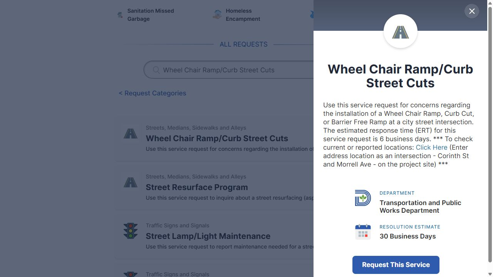

**Figure 20.** The live wheelchair-ramp description displays “Click Here”; the earlier saved record did not capture its destination. [Dallas 311](https://dallascrm.my.site.com/public/s/), captured October 17, 2026.

### 12. Contact information for animal emergencies.

The “Animal Aggressive Behavior” form says the department may contact the resident and asks for a name and phone number. However, the fields in the saved “Contact” step were disabled by default.

Is contact information optional? Does the resident need to give consent before those fields become available? Is contact information required for any emergency response or follow-up?

**POSSIBLE ANSWERS**:
**A.** Contact information is optional; residents must give consent before the fields become available.
**B.** Contact information is required for these reports; the disabled fields reflect a form problem.
**C.** Contact information is optional for submission but required for certain emergency responses or follow-up; the form should explain which ones.
**D.** Other: _____________

**EVIDENCE:**
- [Animal Aggressive Behavior](311/animal-aggressive-behavior.json)

**SCREENSHOT EVIDENCE:**

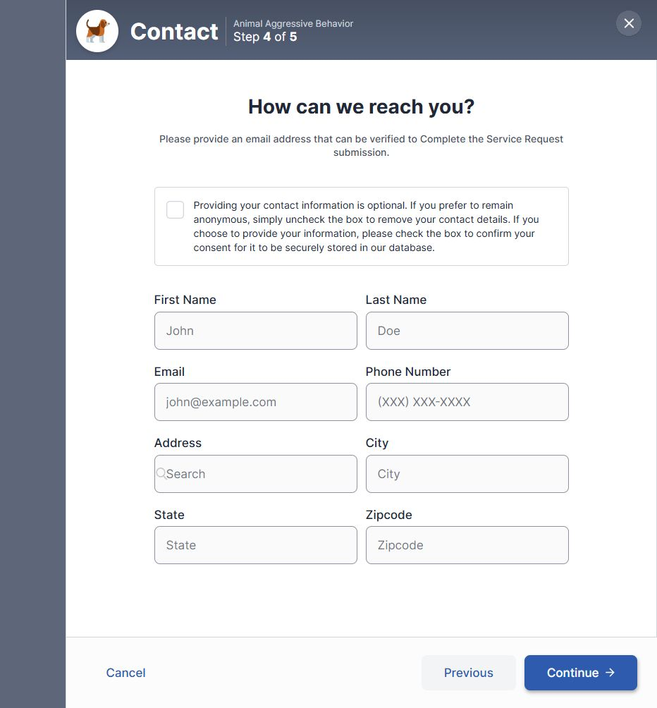

**Figure 21.** The “Animal Aggressive Behavior” contact step labels contact information optional and shows disabled fields while the consent box is unchecked. [Dallas 311](https://dallascrm.my.site.com/public/s/), captured October 17, 2026.

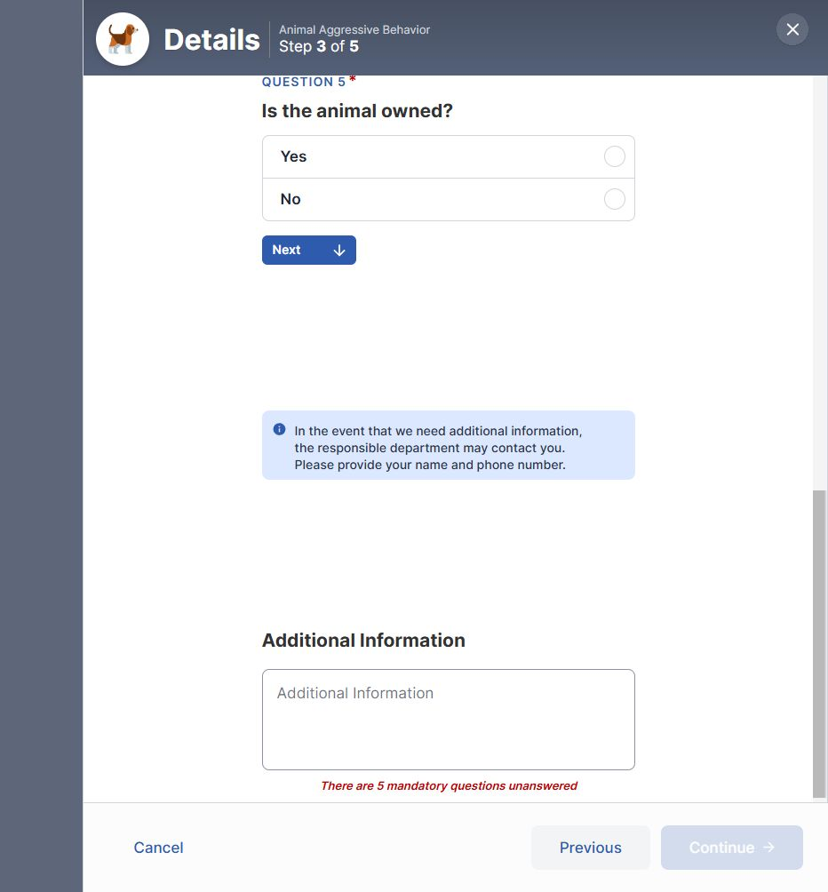

**Figure 22.** The “Animal Aggressive Behavior” details step asks the resident to provide a name and phone number for possible follow-up. [Dallas 311](https://dallascrm.my.site.com/public/s/), captured October 17, 2026.

### 13. Public test records and location errors.

“TEST CRM” and “Test SR's Name” appeared in the saved public inventory with request buttons. Neither request could move past a location error.

Are these services only for internal testing? If so, should they be hidden from the public portal and left out of recommendations to residents? If they are meant for public use, how can a resident choose a valid location and reach the “Details” step?

**Live recheck — October 17, 2026:** Both “TEST CRM” and “Test SR's Name” reached the “Details” step using City Hall’s public address. The earlier location errors were not reproduced. Staff still need to confirm whether these records belong in the public portal.

**POSSIBLE ANSWERS**:
**A.** Both records are internal tests; hide them from the public portal and exclude them from resident recommendations.
**B.** Both are intended for public use, but their location settings are broken; repair those settings and explain valid locations.
**C.** The records have different purposes; staff should confirm which, if either, belongs in the public portal.
**D.** Other: _____________

**EVIDENCE:**
- [TEST CRM](311/test-crm.json)
- [Test SR's Name](311/test-sr-s-name.json)

**SCREENSHOT EVIDENCE:**

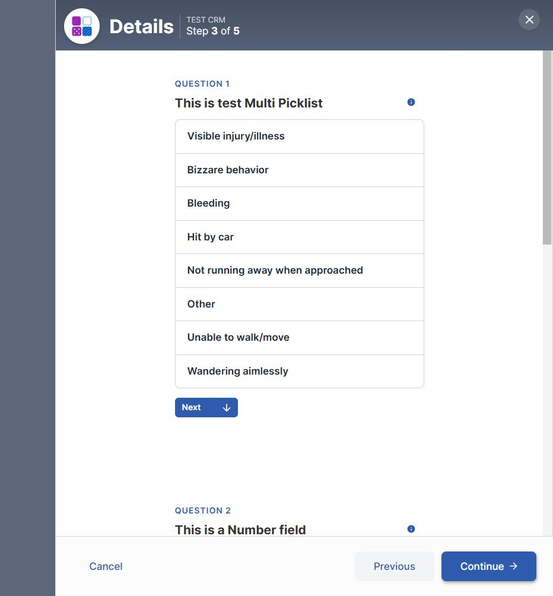

**Figure 23.** Live recheck: “TEST CRM” reached “Details” using the public City Hall address; the earlier location error was not reproduced. [Dallas 311](https://dallascrm.my.site.com/public/s/), captured October 17, 2026.

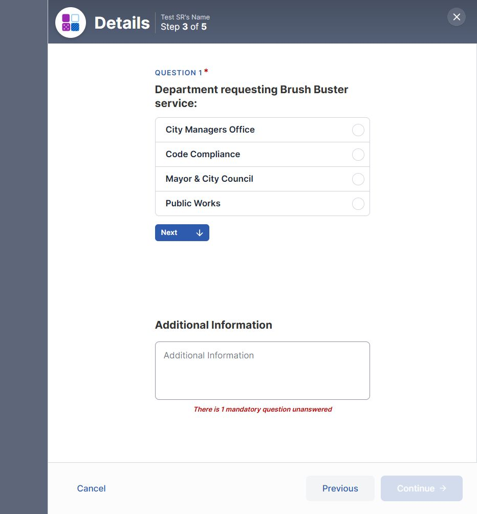

**Figure 24.** Live recheck: “Test SR's Name” also reached “Details” with the public City Hall address. [Dallas 311](https://dallascrm.my.site.com/public/s/), captured October 17, 2026.

### 14. Contact information for food-borne illness reports.

The “Food Borne Illness” description says a name and phone number are required to process a request. The saved “Contact” step says contact information is optional.

Can residents submit an online report without giving their name or phone number? Would the City process that report? Should the description, the field labels, or both be corrected?

**POSSIBLE ANSWERS**:
**A.** A name and phone number are required before the City can process the report; the form should require them.
**B.** Reports without contact information are accepted and processed; update the description to say so.
**C.** The form accepts reports without contact information, but staff cannot investigate them until the resident provides a name and phone number; explain that limit before submission.
**D.** Other: _____________

**EVIDENCE:**
- [Food Borne Illness](311/food-borne-illness.json)

**SCREENSHOT EVIDENCE:**

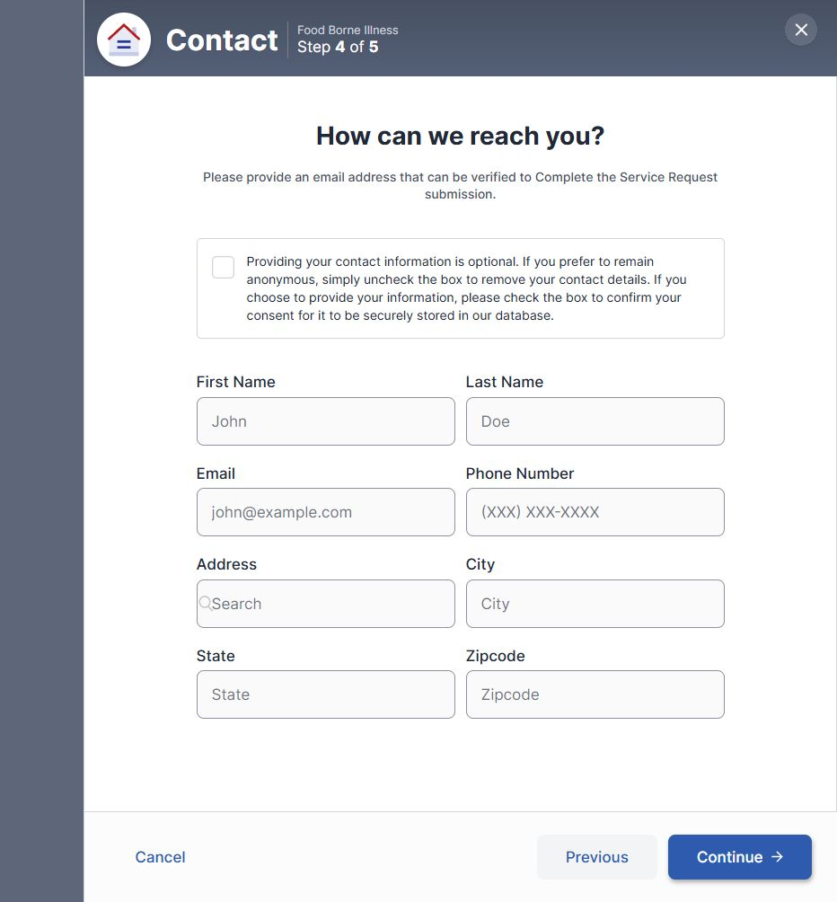

**Figure 25.** The “Food Borne Illness” contact step says contact information is optional and leaves the fields disabled until consent is selected. [Dallas 311](https://dallascrm.my.site.com/public/s/), captured October 17, 2026.

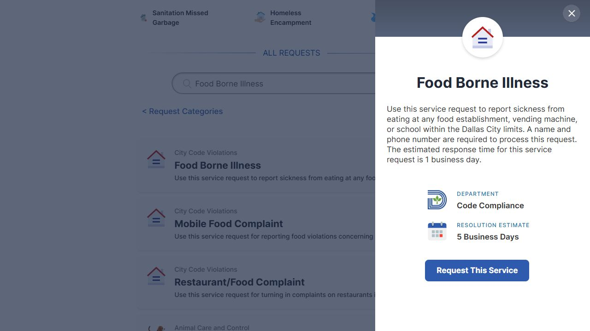

**Figure 26.** The description says a name and phone number are required to process the request. [Dallas 311](https://dallascrm.my.site.com/public/s/), captured October 17, 2026.

### 15. Smoke versus steam in a storm drain.

“Inlet/Storm Drain Cleaning” tells residents to call 311 for smoke in a drain. The saved form includes “Steam” as an answer about what is in the drain. No instruction to call was recorded for that choice.

Is “Steam” intended to mean smoke? Should residents who select “Steam” call 311? Should the form use the label “Smoke” instead?

**POSSIBLE ANSWERS**:
**A.** “Steam” is intended to mean smoke; rename the choice “Smoke” and tell residents to call 311.
**B.** “Steam” and smoke are different conditions; keep “Steam” and add clear instructions for reporting smoke.
**C.** Residents should call 311 for either smoke or steam; add that instruction to the form.
**D.** Other: _____________

**EVIDENCE:**
- [Inlet/Storm Drain Cleaning](311/inlet-storm-drain-cleaning.json)

**SCREENSHOT EVIDENCE:**

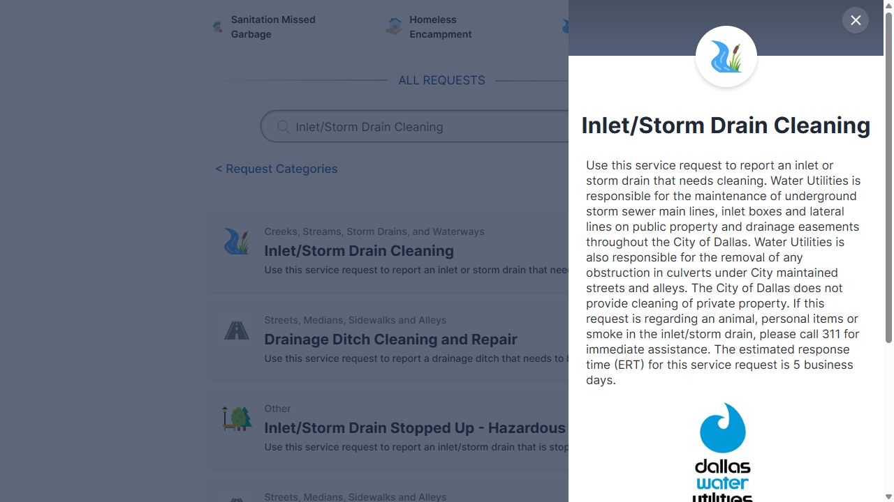

**Figure 27.** The drain-cleaning description tells residents to call 311 for smoke. [Dallas 311](https://dallascrm.my.site.com/public/s/), captured October 17, 2026.

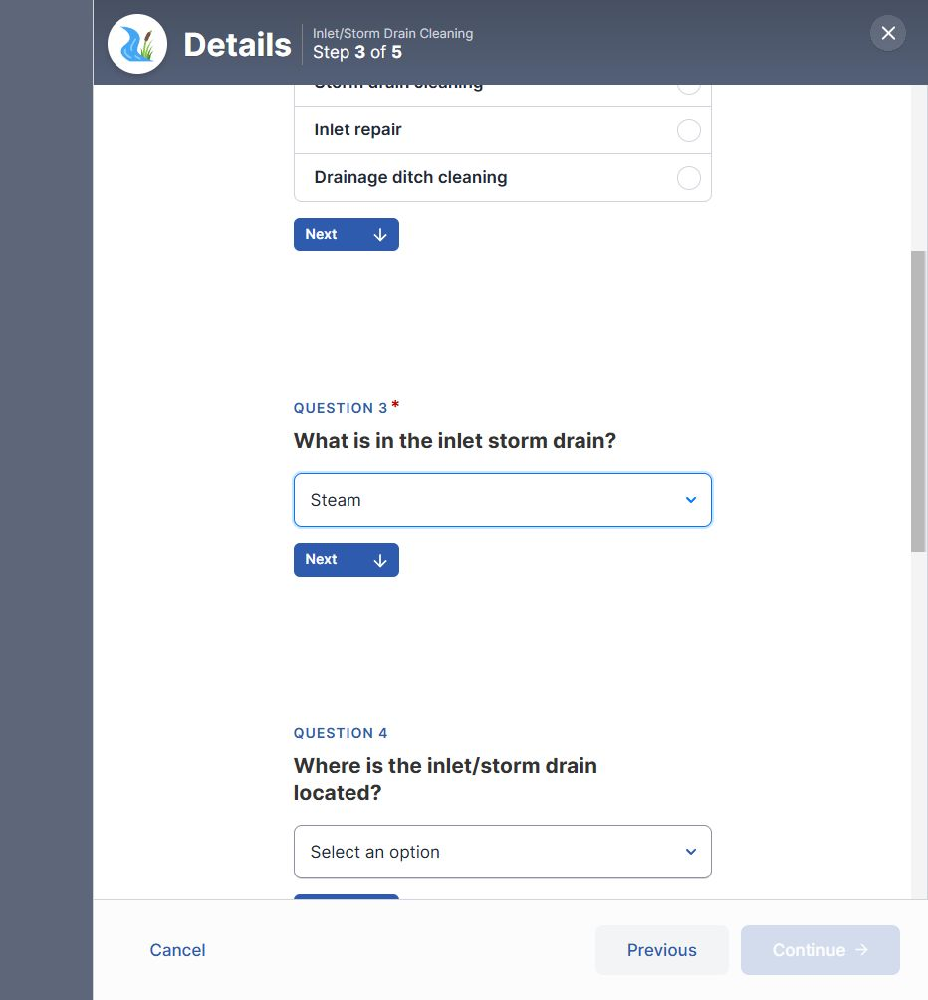

**Figure 28.** The “Inlet/Storm Drain Cleaning” form accepts “Steam”; no call instruction appeared for this choice during the capture. [Dallas 311](https://dallascrm.my.site.com/public/s/), captured October 17, 2026.

### 16. Encampment choices in the housing inquiry form.

The “Housing & Neighborhood Revitalization” description covers help with housing programs. Its form also offers “Homeless encampment” and “Substandard conditions” as types of concern.

Should residents use this form for those concerns? Or should they use “Homeless Encampment” and the services for code concerns? What happens to requests submitted through the housing form under these choices?

**Live recheck — October 17, 2026:** Selecting “Homeless encampment” in the live housing form offers “Homeless Encampment” with “Switch To This Service”. Staff still need to confirm how requests under the other concern types are handled.

**POSSIBLE ANSWERS**:
**A.** Use “Homeless Encampment” and the appropriate code services; remove those choices from the housing form.
**B.** The housing form accepts those concerns and sends them to the responsible teams; explain that process.
**C.** The housing form covers only concerns tied to housing-program help; use the dedicated services for other cases and explain the difference.
**D.** Other: _____________

**EVIDENCE:**
- [Housing & Neighborhood Revitalization](311/housing-neighborhood-revitalization.json)
- [Homeless Encampment](311/homeless-encampment.json)

**SCREENSHOT EVIDENCE:**

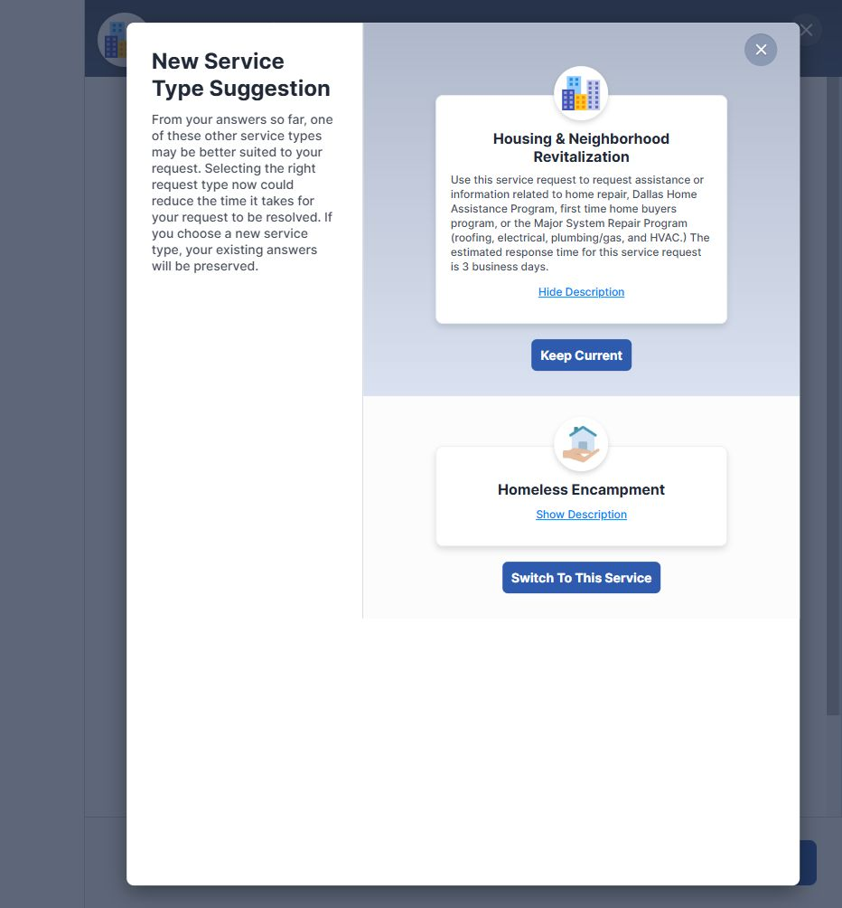

**Figure 29.** Live recheck: selecting “Homeless encampment” in the housing form offers “Homeless Encampment” as a service to switch to. [Dallas 311](https://dallascrm.my.site.com/public/s/), captured October 17, 2026.

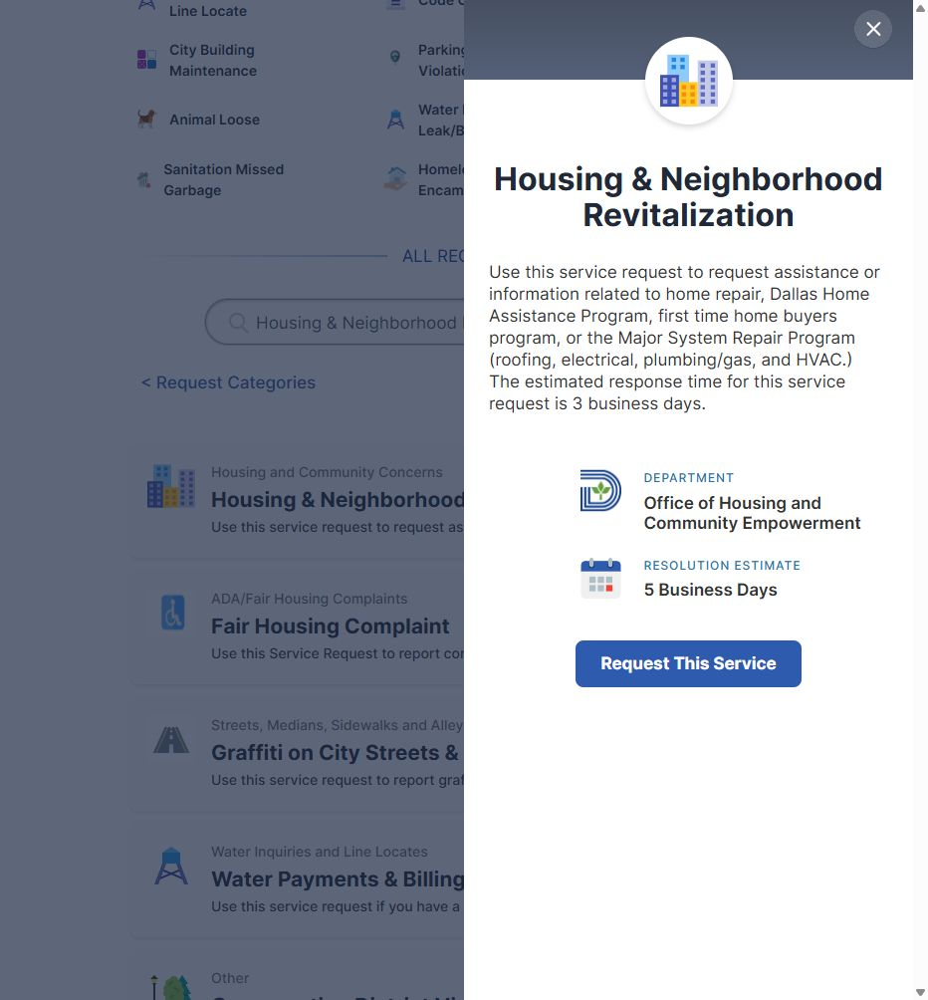

**Figure 30.** The housing service description covers help with housing programs. [Dallas 311](https://dallascrm.my.site.com/public/s/), captured October 17, 2026.

### 17. Hazardous storm-sewer lids: online or phone.

“Lid Cover Broken (Storm Sewer/Manhole)” says to call 311 if the problem appears hazardous. A separate service, “Lid Cover Broken/Missing (Storm Sewer Manhole) - Hazardous”, has an online request button. The saved review also completed that service’s online “Details” step.

Should residents call 311 or submit an online request for a broken or missing cover that could endanger people walking or driving?

**POSSIBLE ANSWERS**:
**A.** Call 311 for hazardous broken or missing covers; remove or limit the online button for hazardous reports.
**B.** Use the hazardous online form; phone reporting is also accepted and reaches the same response team.
**C.** Use either phone or online reporting, but call 311 when the danger is immediate; explain that distinction on both pages.
**D.** Other: _____________

**EVIDENCE:**
- [Lid Cover Broken (Storm Sewer/Manhole)](311/lid-cover-broken-storm-sewer-manhole.json)
- [Lid Cover Broken/Missing (Storm Sewer Manhole) - Hazardous](311/lid-cover-broken-missing-storm-sewer-manhole-hazardous.json)

**SCREENSHOT EVIDENCE:**

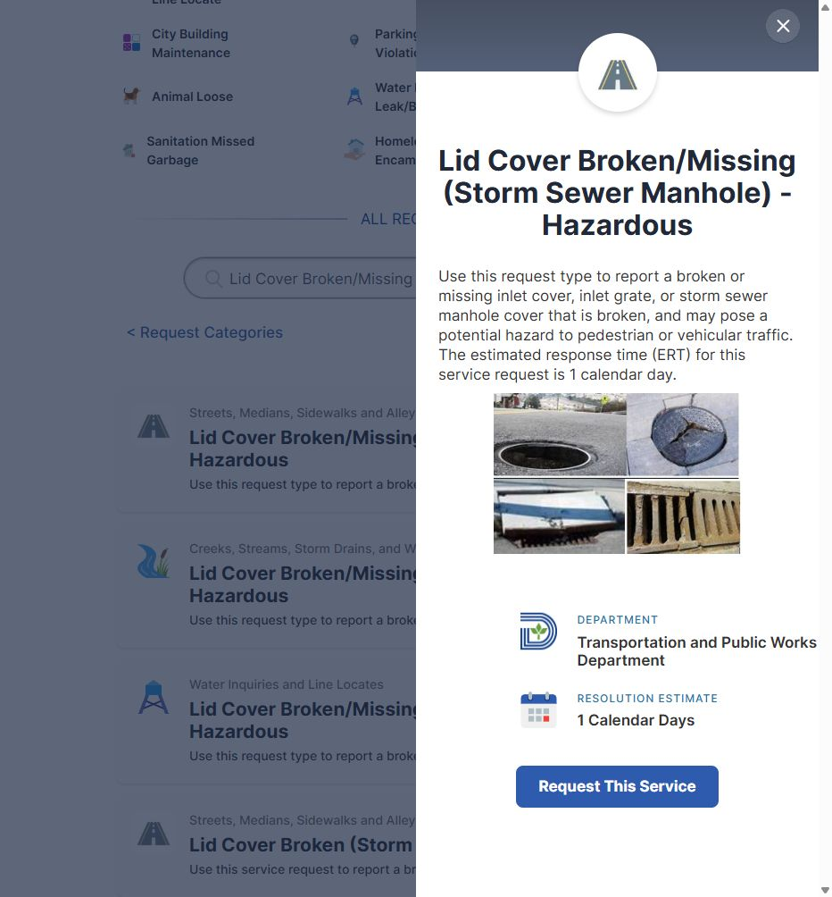

**Figure 31.** The hazardous lid service also offers a “Request This Service” button. [Dallas 311](https://dallascrm.my.site.com/public/s/), captured October 17, 2026.

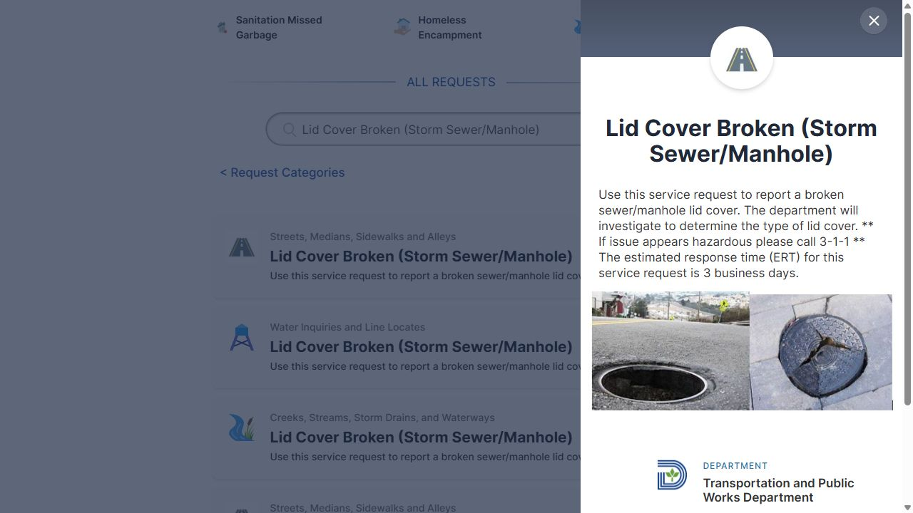

**Figure 32.** The regular lid service says to call 311 if conditions appear hazardous. [Dallas 311](https://dallascrm.my.site.com/public/s/), captured October 17, 2026.

### 18. Food poisoning from a mobile vendor.

“Mobile Food Complaint” says to call 311 for food poisoning or illness caused by food. Its online form also offers “Food Poisoning” as a type of concern.

Should residents call 311, use the “Mobile Food Complaint” form, or use “Food Borne Illness”? Does the correct choice depend on whether the vendor is a truck or a stand?

**Live recheck — October 17, 2026:** Selecting “Food Poisoning” in the live form also offers “Code Concerns” as a service to switch to. The description still tells residents to call 311 for food poisoning.

**POSSIBLE ANSWERS**:
**A.** Call 311 for suspected food poisoning from any mobile vendor; the online choice should direct residents to call.
**B.** Use “Food Borne Illness” for illness reports and “Mobile Food Complaint” for other vendor concerns.
**C.** Use “Mobile Food Complaint” for illness tied to a mobile vendor; its “Food Poisoning” choice sends the report to the correct team.
**D.** The correct service depends on the vendor type; staff should provide separate instructions for trucks and stands.
**E.** Other: _____________

**EVIDENCE:**
- [Mobile Food Complaint](311/mobile-food-complaint.json)
- [Food Borne Illness](311/food-borne-illness.json)

**SCREENSHOT EVIDENCE:**

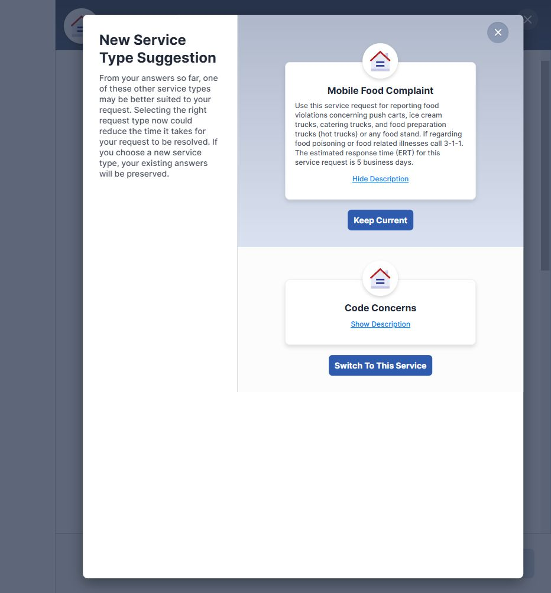

**Figure 33.** Live recheck: selecting “Food Poisoning” in “Mobile Food Complaint” also offers “Code Concerns” as a service to switch to. [Dallas 311](https://dallascrm.my.site.com/public/s/), captured October 17, 2026.

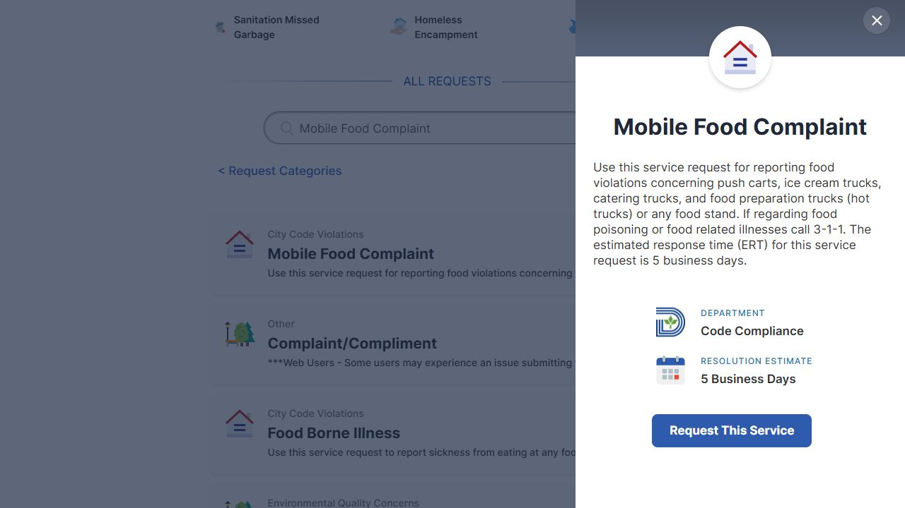

**Figure 34.** The mobile-food description tells residents to call 311 for food poisoning. [Dallas 311](https://dallascrm.my.site.com/public/s/), captured October 17, 2026.

### 19. Construction service names and the work they cover.

“Paving Reconstruction Project” tells residents to use “Construction Status Inquiry/Status” for utility work or work by other contractors. The saved public service is named “Construction Right of Way/Status Inquiry”. That service also says it covers City projects, which may also fall under “Paving Reconstruction Project”.

Do “Construction Status Inquiry/Status” and “Construction Right of Way/Status Inquiry” refer to the same service? When City construction is underway, how should residents choose between that service and “Paving Reconstruction Project”?

**POSSIBLE ANSWERS**:
**A.** The two construction inquiry names refer to the same service; use “Paving Reconstruction Project” for City paving and “Construction Right of Way/Status Inquiry” for utility or other contractor work.
**B.** The two inquiry names refer to the same service, and either public service can accept questions about City paving projects.
**C.** The names refer to separate services with different coverage; staff should provide the correct public name and reporting instructions for each type of project.
**D.** Other: _____________

**EVIDENCE:**
- [Paving Reconstruction Project](311/paving-reconstruction-project.json)
- [Construction Right of Way/Status Inquiry](311/construction-right-of-way-status-inquiry.json)

**SCREENSHOT EVIDENCE:**

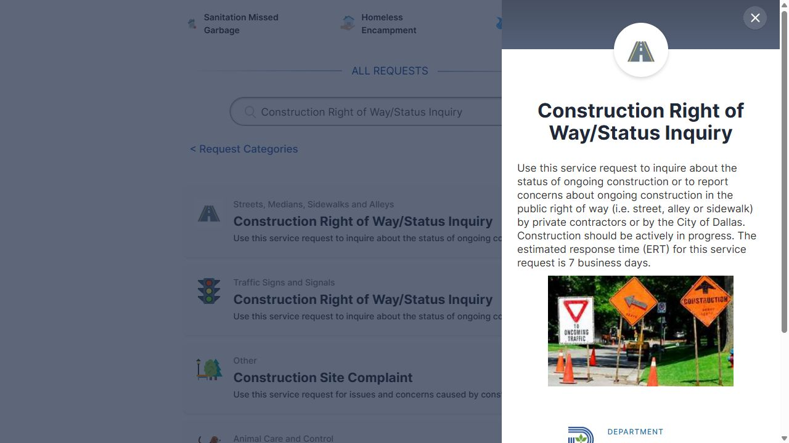

**Figure 35.** The public title is “Construction Right of Way/Status Inquiry”, and its description includes City work. [Dallas 311](https://dallascrm.my.site.com/public/s/), captured October 17, 2026.

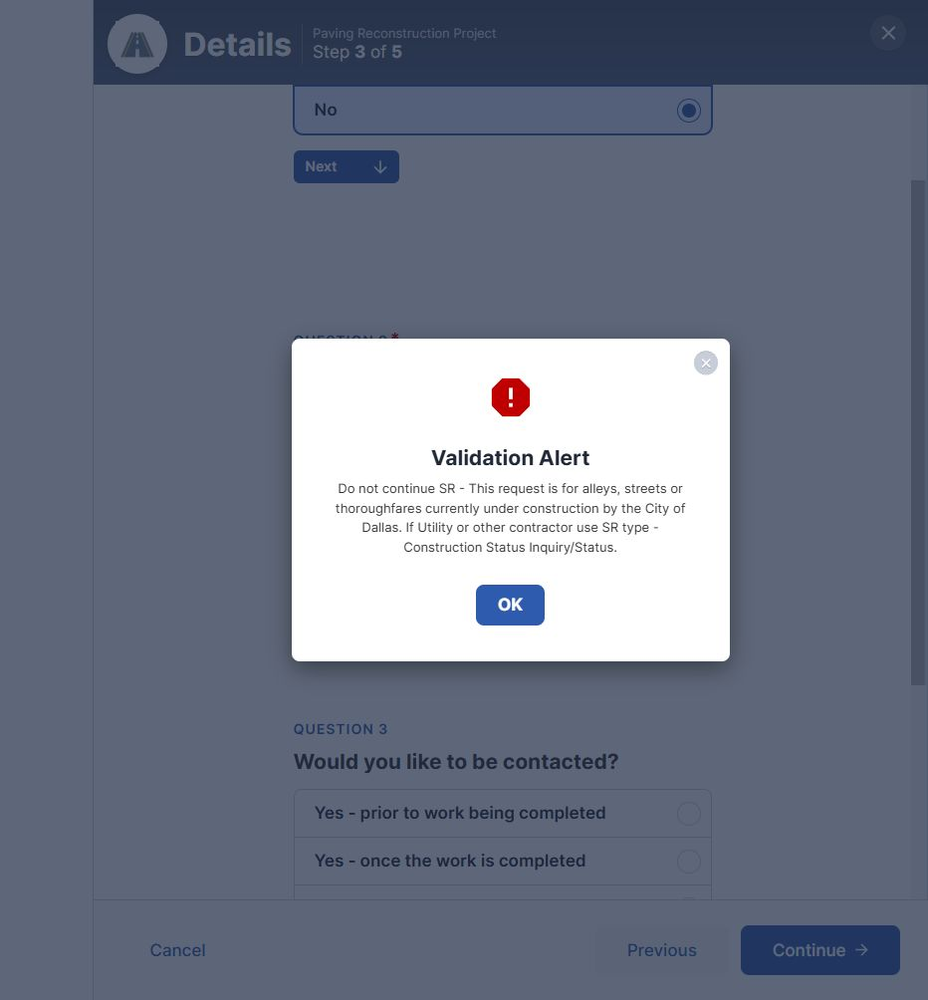

**Figure 36.** The “Paving Reconstruction Project” alert refers utility or contractor work to “Construction Status Inquiry/Status”. [Dallas 311](https://dallascrm.my.site.com/public/s/), captured October 17, 2026.

### 20. Park encampments and loose dogs.

“Park Maintenance/Misc” says Park & Recreation does not handle encampments. However, a suggestion popup recommended “Park Maintenance/Misc” for an encampment. The service also says Park Rangers cannot capture loose dogs that have no owner.

Should residents use “Homeless Encampment” to report an encampment in a park? Should they use “Animal Loose” for a loose dog with no owner in a park, or is another service responsible?

**Live recheck — October 17, 2026:** The live popup includes a separate “Homeless Encampment” option with “Switch To This Service”. The saved observation did not record this option.

**POSSIBLE ANSWERS**:
**A.** Use “Homeless Encampment” for park encampments and “Animal Loose” for loose dogs with no owner; correct the park service suggestion.
**B.** Use “Park Maintenance/Misc” to report both concerns; park staff send them to the teams that can respond.
**C.** Use “Homeless Encampment” for encampments and call 311 for loose dogs in parks so staff can arrange a response.
**D.** Other: _____________

**EVIDENCE:**
- [Park Maintenance/Misc](311/park-maintenance-misc.json)
- [Homeless Encampment](311/homeless-encampment.json)
- [Animal Loose](311/animal-loose.json)

**SCREENSHOT EVIDENCE:**

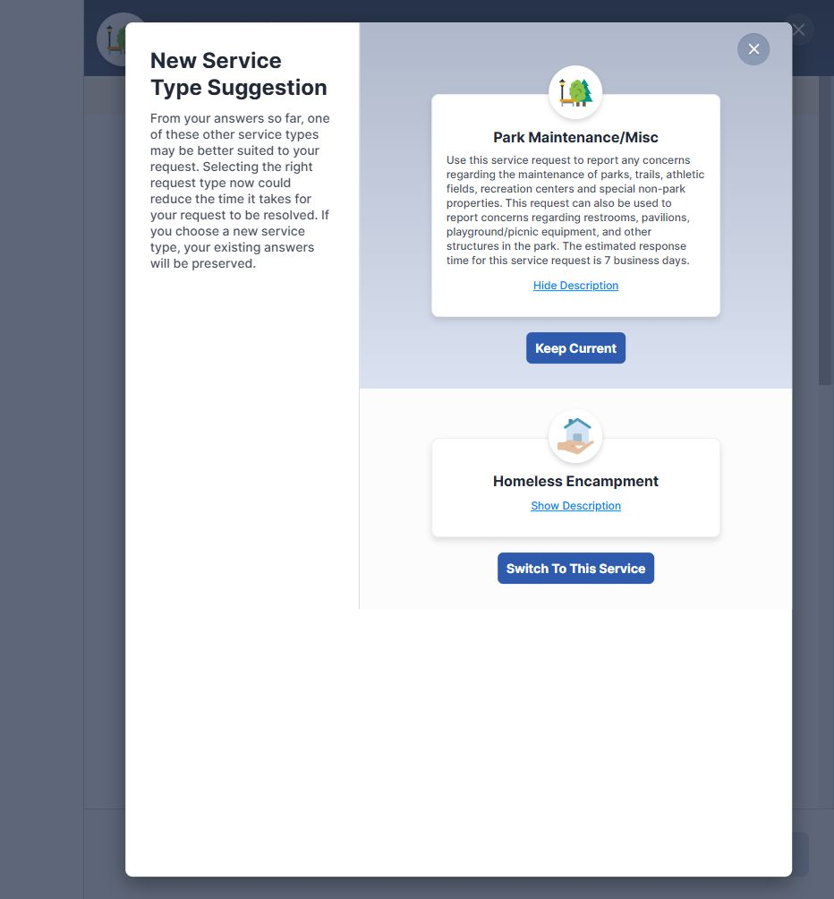

**Figure 37.** Live recheck: the popup offers “Homeless Encampment” with “Switch To This Service”, unlike the earlier saved observation. [Dallas 311](https://dallascrm.my.site.com/public/s/), captured October 17, 2026.

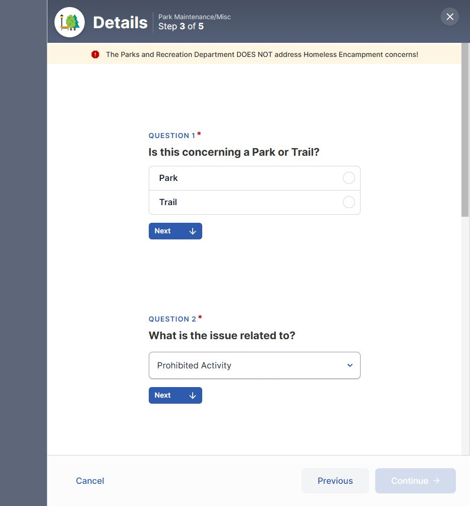

**Figure 38.** The “Park Maintenance/Misc” form says Parks and Recreation does not address encampments. [Dallas 311](https://dallascrm.my.site.com/public/s/), captured October 17, 2026.

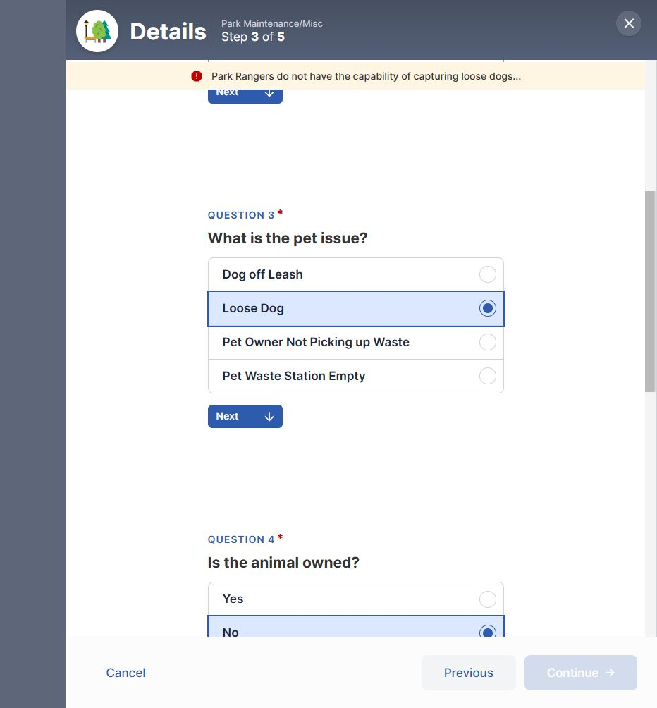

**Figure 39.** The “Park Maintenance/Misc” form says Park Rangers cannot capture loose dogs after “No” is selected for ownership. [Dallas 311](https://dallascrm.my.site.com/public/s/), captured October 17, 2026.

### 21. Different fees for an extra garbage cart.

The “Sanitation Roll Cart Maintenance/Delivery” description says an extra residential garbage cart costs **$15.51**. The saved form instructions give a price of **$35.81**.

Which fee is current, and when did it change? Should the public description be corrected?

**Live recheck — October 17, 2026:** The live additional-cart alert now lists $15.51, matching the description. The saved $35.81 alert was not reproduced. Staff still need to confirm the official fee and when it took effect.

**POSSIBLE ANSWERS**:
**A.** The current fee is $15.51; correct the form and provide the date that fee took effect.
**B.** The current fee is $35.81; correct the description and provide the date that fee took effect.
**C.** Both amounts are valid for different charges or circumstances; explain when each applies and when those charges began.
**D.** Other: _____________

**EVIDENCE:**
- [Sanitation Roll Cart Maintenance/Delivery](311/sanitation-roll-cart-maintenance-delivery.json)

**SCREENSHOT EVIDENCE:**

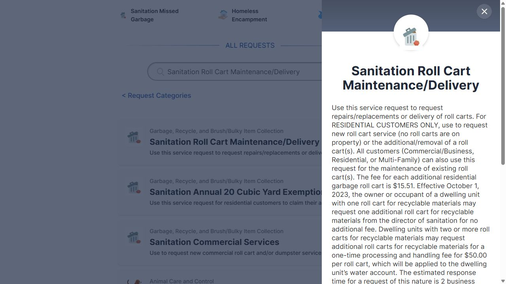

**Figure 40.** The description lists a $15.51 charge for an additional residential garbage cart. [Dallas 311](https://dallascrm.my.site.com/public/s/), captured October 17, 2026.

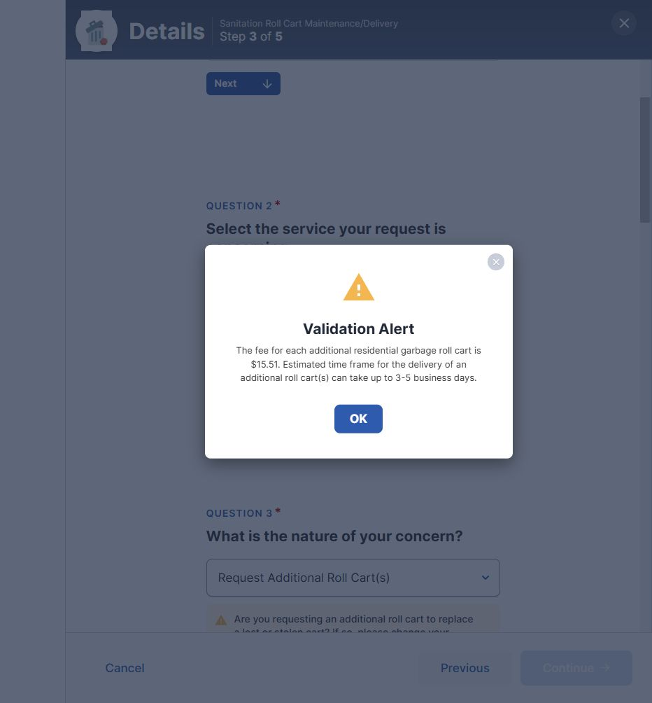

**Figure 41.** Live recheck: the additional-cart alert now says $15.51, matching the description; the saved form had said $35.81. [Dallas 311](https://dallascrm.my.site.com/public/s/), captured October 17, 2026.

### 22. Dead animals in Dowdy Ferry/Teagarden.

The “Sanitation Dead Animal Pick Up” form prevents residents from continuing when they answer “Yes” to “Is the animal in the Dowdy Ferry/Teagarden area?” It tells them to choose “Illegal Dumping” instead, but the saved public inventory has no service with that exact name.

Which service should residents use? If they suspect someone dumped the animal, should they call so staff can send a crew, or submit an online report?

**POSSIBLE ANSWERS**:
**A.** Use “Illegal Dumping Urgent”; “Illegal Dumping” is a shortened or old name for that service.
**B.** Use “Code Concerns” for these reports; update the blocked form message with that exact name.
**C.** Call 311 so staff can send the report to the team handling suspected dumping in Dowdy Ferry/Teagarden.
**D.** Other: _____________

**EVIDENCE:**
- [Sanitation Dead Animal Pick Up](311/sanitation-dead-animal-pick-up.json)
- [Illegal Dumping Urgent](311/illegal-dumping-urgent.json)
- [Code Concerns](311/code-concerns.json)

**SCREENSHOT EVIDENCE:**

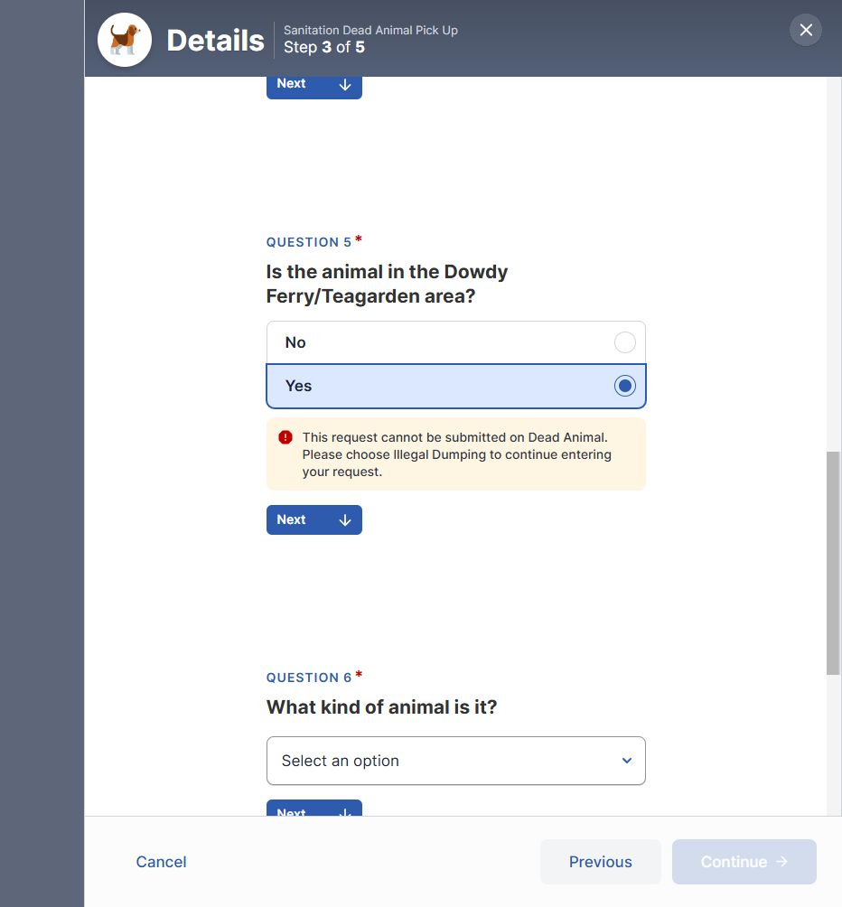

**Figure 42.** In “Sanitation Dead Animal Pick Up”, selecting “Yes” for Dowdy Ferry/Teagarden produces an “Illegal Dumping” instruction. [Dallas 311](https://dallascrm.my.site.com/public/s/), captured October 17, 2026.

### 23. Sand removal on secondary thoroughfares.

“Sand Removal Request” says secondary thoroughfares are swept within 30 days after a snow or ice event. However, the form lists only “Bridge/sidewalk”, “Bus route”, “Emergency room entrance”, and “Major thoroughfare” as location choices.

How should residents request sand removal on a secondary thoroughfare? Do they need to submit a request before the sweep that is due within 30 days?

**POSSIBLE ANSWERS**:
**A.** Secondary thoroughfares are swept without individual requests within 30 days; call 311 only if the sweep is overdue.
**B.** Residents can request removal before the scheduled sweep, but the form is missing a “Secondary thoroughfare” choice; add it.
**C.** Call 311 for secondary thoroughfares; the online form is limited to the locations it lists.
**D.** Other: _____________

**EVIDENCE:**
- [Sand Removal Request](311/sand-removal-request.json)

**SCREENSHOT EVIDENCE:**

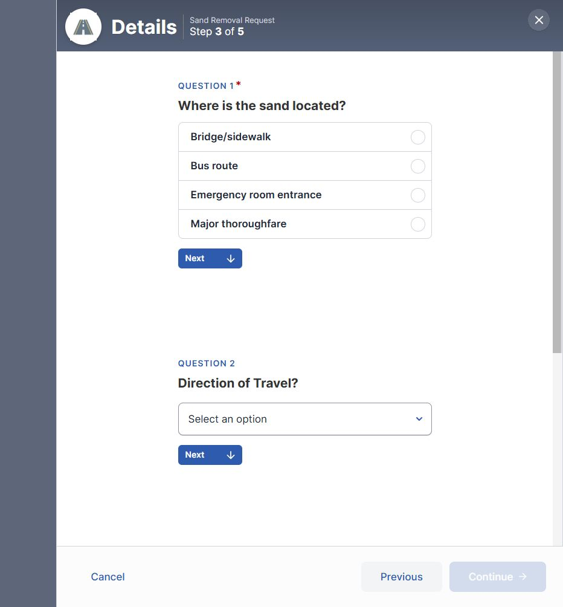

**Figure 43.** The “Sand Removal Request” location choices do not include “Secondary thoroughfare”. [Dallas 311](https://dallascrm.my.site.com/public/s/), captured October 17, 2026.

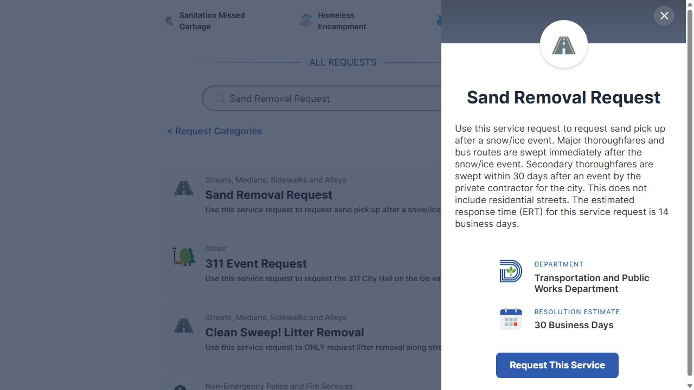

**Figure 44.** The description says secondary thoroughfares are swept within 30 days. [Dallas 311](https://dallascrm.my.site.com/public/s/), captured October 17, 2026.

### 24. Requesting Cost-Plus after using the annual exemption.

“Sanitation Annual 20 Cubic Yard Exemption” says residents can still use “Cost-Plus” after they have used their annual exemption. No saved public service is named “Cost-Plus”.

How can a residential customer request this service and find out what it costs? Should the online alert include a link to it?

**POSSIBLE ANSWERS**:
**A.** Call 311 to request “Cost-Plus” and receive pricing information; add that instruction to the alert.
**B.** Request “Cost-Plus” through a separate Sanitation contact or form that staff must identify; link to it from the alert.
**C.** “Cost-Plus” is requested through an existing public service under a different name; staff should provide that name and explain how charges are set.
**D.** Other: _____________

**EVIDENCE:**
- [Sanitation Annual 20 Cubic Yard Exemption](311/sanitation-annual-20-cubic-yard-exemption.json)

**SCREENSHOT EVIDENCE:**

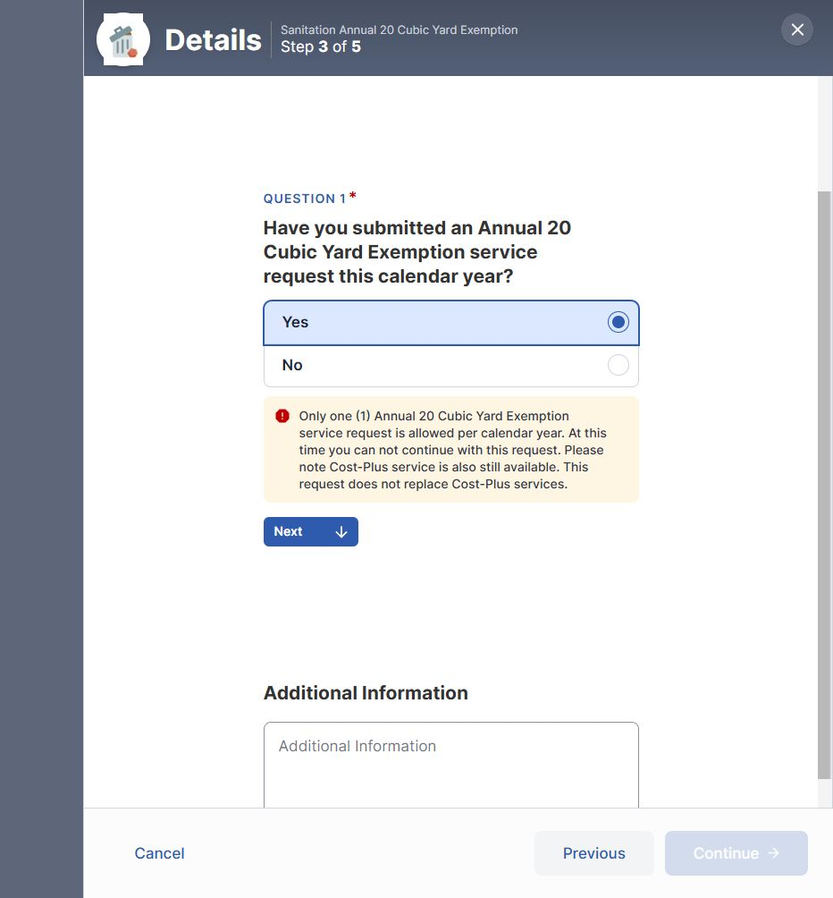

**Figure 45.** The annual exemption form blocks another exemption but says “Cost-Plus” is still available. [Dallas 311](https://dallascrm.my.site.com/public/s/), captured October 17, 2026.

### 25. Completely dark traffic signals: phone or online.

“Traffic Signal - Lights Out All Directions” says staff must send a crew and tells residents to call 311. The public page also has a “Request This Service” button. In the saved review, the online form could move from “Details” to “Contact”.

Should residents call 311 whenever a traffic signal is dark in all directions? Should the online button be removed, or should it be available only for a different situation?

**POSSIBLE ANSWERS**:
**A.** Call 311 for all signals that are dark in every direction; remove the online button for this situation.
**B.** Phone and online reports both send a crew; explain that either method is accepted.
**C.** Keep online reporting for situations that are no longer urgent; tell residents to call 311 while the signal remains dark.
**D.** Other: _____________

**EVIDENCE:**
- [Traffic Signal - Lights Out All Directions](311/traffic-signal-lights-out-all-directions.json)

**SCREENSHOT EVIDENCE:**

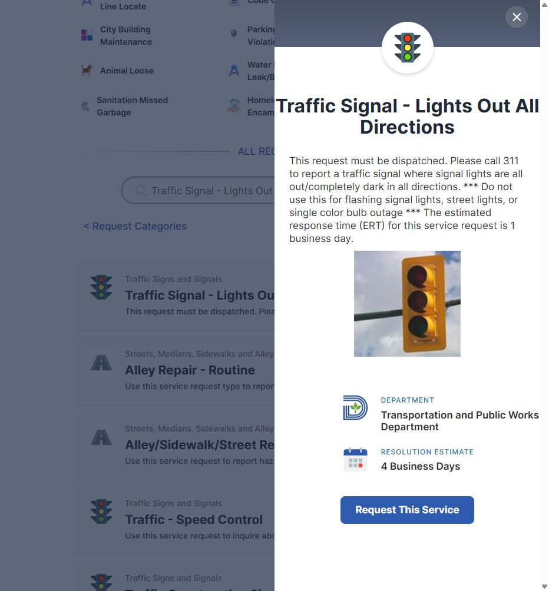

**Figure 46.** The same “Traffic Signal - Lights Out All Directions” panel also offers “Request This Service”. [Dallas 311](https://dallascrm.my.site.com/public/s/), captured October 17, 2026.

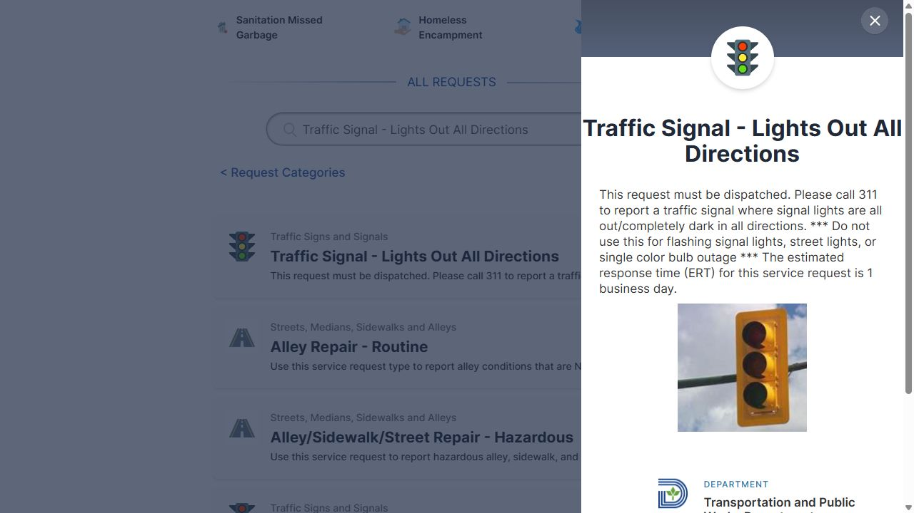

**Figure 47.** “Traffic Signal - Lights Out All Directions” says the request must be dispatched and tells residents to call 311. [Dallas 311](https://dallascrm.my.site.com/public/s/), captured October 17, 2026.

### 26. Street resurfacing and the “Street Repair” name.

“Street Resurface Program” tells residents to use “Street Repair (Routine)” for a first request to resurface a street or for a project that is no longer under construction. The saved public service is named “Street Repair”.

Do “Street Repair (Routine)” and “Street Repair” refer to the same service? Can “Street Repair” accept an initial request to resurface a street, as well as requests for minor repairs?

**POSSIBLE ANSWERS**:
**A.** Both names refer to “Street Repair”, which accepts both initial resurfacing requests and minor repair reports.
**B.** Both names refer to “Street Repair”, but it handles minor repairs only; the resurfacing page should name a different service for initial requests.
**C.** “Street Repair (Routine)” is a separate service missing from the public portal; staff should explain how residents can reach it.
**D.** Other: _____________

**EVIDENCE:**
- [Street Resurface Program](311/street-resurface-program.json)
- [Street Repair](311/street-repair.json)

**SCREENSHOT EVIDENCE:**

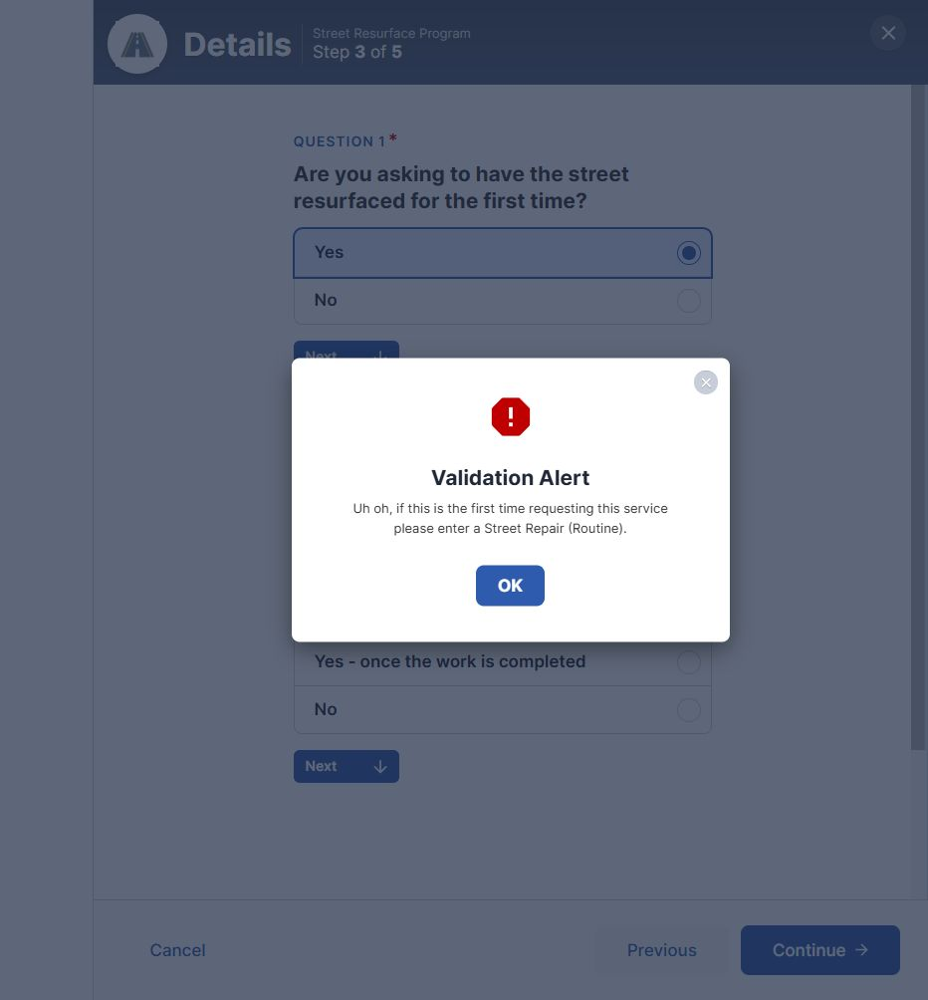

**Figure 48.** The “Street Resurface Program” alert tells first-time requesters to enter “Street Repair (Routine)”. [Dallas 311](https://dallascrm.my.site.com/public/s/), captured October 17, 2026.

### 27. Emergency flooding in a form for nonemergency services.

“Storm Drainage/Flooding Complaint” says it is for nonemergency services only. Its “Details” form asks, “Is this an emergency flooding situation that is happening now?” The form accepted “Yes”, and no warning or instruction to use another service was recorded.

How should residents report emergency flooding that is happening now, especially if water has entered a building?

**POSSIBLE ANSWERS**:
**A.** Call 311 and ask for “Flooding Emergency”; the nonemergency form should show that instruction when “Yes” is selected.
**B.** Use the “Flooding Emergency” service directly; the nonemergency form should send residents to its page.
**C.** The current form sends “Yes” answers to the emergency response team; explain that behavior and when a phone call is also needed.
**D.** Other: _____________

**EVIDENCE:**
- [Storm Drainage/Flooding Complaint](311/storm-drainage-flooding-complaint.json)
- [Flooding Emergency](311/flooding-emergency.json)

**SCREENSHOT EVIDENCE:**

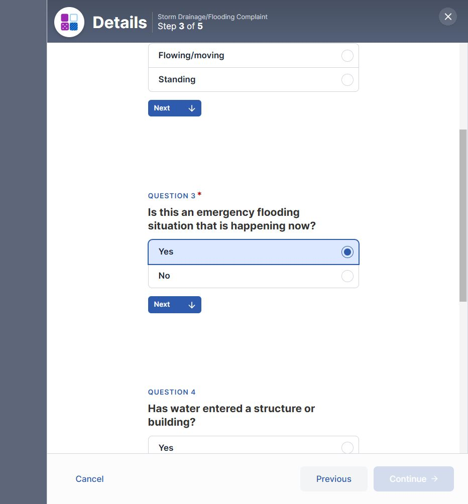

**Figure 49.** The nonemergency “Storm Drainage/Flooding Complaint” form accepts “Yes” for flooding happening now without showing an alert at this step. [Dallas 311](https://dallascrm.my.site.com/public/s/), captured October 17, 2026.

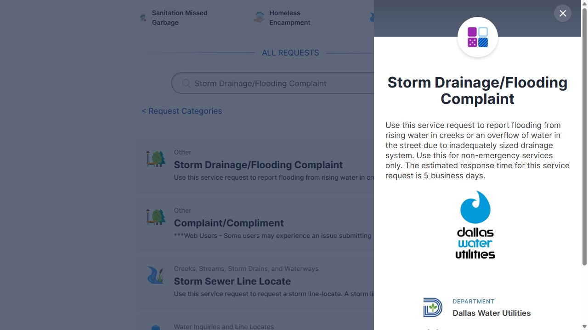

**Figure 50.** The flooding complaint description limits the service to nonemergency concerns. [Dallas 311](https://dallascrm.my.site.com/public/s/), captured October 17, 2026.

### 28. Other types of work in the water-project form.

“Water/Sanitary Sewer Construction Project” says it covers questions about water and wastewater projects. Its form also offers “Road work”, “Stormwater”, “Utility Work - Natural gas”, and “Utility Work - Phone/Internet lines”. No instructions to use another service were observed for those choices.

Does Dallas Water Utilities handle questions about all of these types of work through this form? If some belong with another department, which service should residents use?

**POSSIBLE ANSWERS**:
**A.** Dallas Water Utilities accepts questions about every listed type of work and sends them to the responsible department when needed.
**B.** The form should accept only water and wastewater project questions; remove unrelated choices and name the correct services.
**C.** The form accepts other types of work only when they are part of a water or wastewater project; explain that limit beside the choices.
**D.** Other: _____________

**EVIDENCE:**
- [Water/Sanitary Sewer Construction Project](311/water-sanitary-sewer-construction-project.json)

**SCREENSHOT EVIDENCE:**

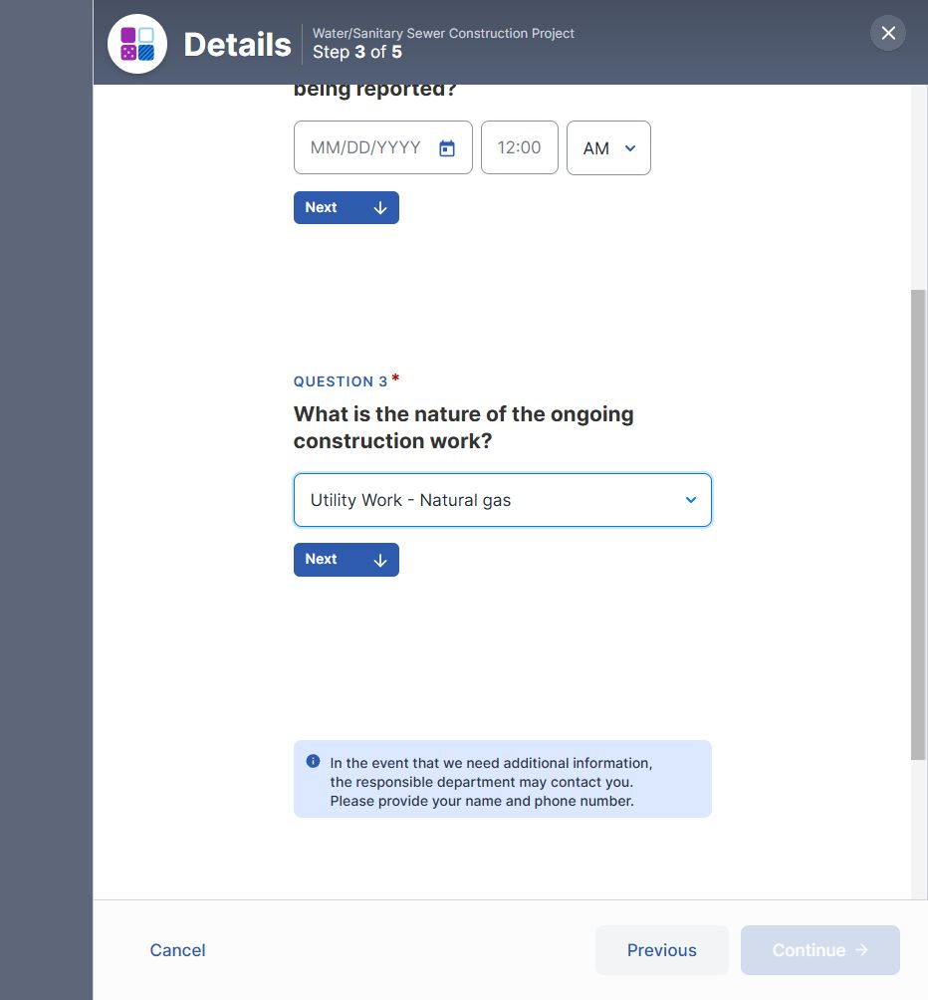

**Figure 51.** In “Water/Sanitary Sewer Construction Project”, the form accepts “Utility Work - Natural gas” as the work type. [Dallas 311](https://dallascrm.my.site.com/public/s/), captured October 17, 2026.

**Figure 52.** The water construction description covers water and wastewater projects. [Dallas 311](https://dallascrm.my.site.com/public/s/), captured October 17, 2026.

### 29. Service names for new street lights.

The “Traffic Signal - New” form tells residents to use “Street Light - Maintenance/New SR” for street lights. The saved public portal instead has “Street Lamp/Light - New/Relocation” and “Street Lamp/Light Maintenance”.

Which public service should residents use to request a new light, move an existing light, or request maintenance? Should the “Traffic Signal - New” form use those exact public names?

**POSSIBLE ANSWERS**:
**A.** Use “Street Lamp/Light - New/Relocation” for new lights and moves, and “Street Lamp/Light Maintenance” for maintenance; update the signal form.
**B.** “Street Light - Maintenance/New SR” is an internal service covering all three requests; residents should call 311 to reach it.
**C.** The correct service also depends on who owns the light; staff should explain when to use the City services and when to contact another owner.
**D.** Other: _____________

**EVIDENCE:**
- [Traffic Signal - New](311/traffic-signal-new.json)
- [Street Lamp/Light - New/Relocation](311/street-lamp-light-new-relocation.json)
- [Street Lamp/Light Maintenance](311/street-lamp-light-maintenance.json)

**SCREENSHOT EVIDENCE:**

**Figure 53.** The “Traffic Signal - New” form uses the literal referral name “Street Light - Maintenance/New SR”. [Dallas 311](https://dallascrm.my.site.com/public/s/), captured October 17, 2026.

### 30. Dumpster service choices for commercial properties.

“Sanitation Commercial Services” says only City facilities may request dumpster service. During the saved review, the form also offered “Dumpster Service” when the “Business/Commercial” and “Multi-Family Complex” property types were selected.

Does the form reject those requests at a later step, or can properties that are not City facilities apply? Should the form hide or block the choice for properties that do not qualify?

**POSSIBLE ANSWERS**:
**A.** Only City facilities qualify; hide or block “Dumpster Service” for the other property types.
**B.** Businesses and multifamily properties may also qualify; update the description to explain the requirements.
**C.** Only City facilities qualify, and staff reject other requests later; add an earlier warning so residents do not complete an invalid request.
**D.** Other: _____________

**EVIDENCE:**
- [Sanitation Commercial Services](311/sanitation-commercial-services.json)

**SCREENSHOT EVIDENCE:**

**Figure 54.** The commercial-service form lists “Business/Commercial” among its property types. [Dallas 311](https://dallascrm.my.site.com/public/s/), captured October 17, 2026.

**Figure 55.** With “Business/Commercial” selected in “Sanitation Commercial Services”, the form allows “Dumpster Service” to be chosen. [Dallas 311](https://dallascrm.my.site.com/public/s/), captured October 17, 2026.

**Figure 56.** The commercial service description limits dumpster requests to City facilities. [Dallas 311](https://dallascrm.my.site.com/public/s/), captured October 17, 2026.

### 31. Reporting urgent water pollution by phone.

“Water Pollution Urgent” covers urgent reports of dumped material that could reach waterways. Its page has no “Request This Service” button. The only saved instruction says to call 311 “for more information”.

Is calling 311 also the required way to report the problem so staff can send a crew? If residents should report it another way, should the page explain how?

**POSSIBLE ANSWERS**:
**A.** Call 311 to report urgent water pollution and arrange a response; replace “for more information” with clear reporting instructions.
**B.** Use a separate urgent contact number or reporting service; staff should supply it and add it to the page.
**C.** An online request is intended to be available; restore the button and explain whether urgent cases also require a call.
**D.** Other: _____________

**EVIDENCE:**
- [Water Pollution Urgent](311/water-pollution-urgent.json)

**SCREENSHOT EVIDENCE:**

**Figure 57.** The urgent pollution page ends with “Please call 311 for more information” and has no request button in this panel. [Dallas 311](https://dallascrm.my.site.com/public/s/), captured October 17, 2026.

### 32. Hazardous trees on private property.

“Tree down/Low Limbs - Hazardous” says owners are responsible for trees on private property. Its form also suggests “Code Concerns” when the resident selects “Private property”.

When should residents contact the owner, submit a “Code Concerns” request, or contact the utility whose lines are touching the tree? Does responsibility change if the tree leans into the public right-of-way?

**POSSIBLE ANSWERS**:
**A.** Contact the owner for private-property trees, use “Code Concerns” for possible code violations, and contact the utility when its lines are affected; explain when a public response is needed.
**B.** Use “Code Concerns” for hazardous private-property trees; staff decide whether the owner, utility, or a City team must respond.
**C.** Call 311 when a private-property tree threatens the public right-of-way; contact the owner or affected utility for concerns limited to private property.
**D.** Other: _____________

**EVIDENCE:**
- [Tree down/Low Limbs - Hazardous](311/tree-down-low-limbs-hazardous.json)
- [Code Concerns](311/code-concerns.json)

**SCREENSHOT EVIDENCE:**

**Figure 58.** Selecting “Private property” in “Tree down/Low Limbs - Hazardous” produces a “Code Concerns” suggestion. [Dallas 311](https://dallascrm.my.site.com/public/s/), captured October 17, 2026.

**Figure 59.** The hazardous-tree description assigns private-property trees to the owner. [Dallas 311](https://dallascrm.my.site.com/public/s/), captured October 17, 2026.

### 33. Beekeeper notices by phone or email.

“Mosquito Beekeeper Notification” says the City gives notice by email **4–7 hours before ground spraying** and **12–24 hours before aerial spraying**. However, the form for aerial spraying offers “Phone” as a preferred contact method. When “Phone” was selected, the saved form did not ask for an email address.

Does the City call residents about aerial spraying when they select “Phone”? If so, where does the form collect their phone number, and does the City give the same amount of advance notice? What happens when residents select “Both”, but the form collects only an email address?

**POSSIBLE ANSWERS**:
**A.** “Phone” and “Both” are valid; the number is collected at another step, and the same advance notice applies. Identify that step and confirm how both contacts are used.
**B.** Notices are sent only by email; remove “Phone” and “Both” and require an email address.
**C.** Phone notices are available, but the form is missing the needed contact fields; repair the fields and state the notice times for each method.
**D.** Notice times differ by contact method or spraying type; staff should provide the schedule and required contact details for each choice.
**E.** Other: _____________

**EVIDENCE:**
- [Mosquito Beekeeper Notification](311/mosquito-beekeeper-notification.json)

**SCREENSHOT EVIDENCE:**

**Figure 60.** In “Mosquito Beekeeper Notification”, the email notice promise remains above the selected “Phone” choice. [Dallas 311](https://dallascrm.my.site.com/public/s/), captured October 17, 2026.

### 34. Hazardous debris on a residential street.

“Street Sweeping - Thoroughfares” says to call 311 and ask for “Street Spillage/Debris in Right-of-Way - Hazardous” when glass or other harmful material is on a residential street. The saved public service is named “Street Spillage/Debris in Right of Way”, and it has an online request button.

Do these names refer to the same service? Should residents call 311 for hazardous debris on a residential street even though the public page offers an online request?

**POSSIBLE ANSWERS**:
**A.** Both names refer to the same service, but residents should call 311 for residential-street hazards so staff can arrange a prompt response.
**B.** Both names refer to the same service, and phone or online reports are accepted for residential-street hazards.
**C.** The hazardous service is separate and available only through 311; update the public instructions to explain the difference.
**D.** Other: _____________

**EVIDENCE:**
- [Street Sweeping - Thoroughfares](311/street-sweeping-thoroughfares.json)
- [Street Spillage/Debris in Right of Way](311/street-spillage-debris-in-right-of-way.json)

**SCREENSHOT EVIDENCE:**

**Figure 61.** The sweeping description tells residents to call 311 for hazardous debris on residential streets. [Dallas 311](https://dallascrm.my.site.com/public/s/), captured October 17, 2026.

### 35. A required sidewalk description when “Other” is not selected.

The “Sidewalk Replacement Program” form marked “If other, please describe:” as required even when a property owner selected a specific problem, such as “Concrete broken”.

Is every property owner supposed to fill in this field? Or should the field appear and become required only when the owner selects “Other”?

**POSSIBLE ANSWERS**:
**A.** The description field is required for every property owner; rename it so the label matches that requirement.
**B.** The field should appear and be required only when “Other” is selected; fix the form condition.
**C.** The field may appear for every answer, but it should be optional unless “Other” is selected.
**D.** Other: _____________

**EVIDENCE:**
- [Sidewalk Replacement Program](311/sidewalk-replacement-program.json)

**SCREENSHOT EVIDENCE:**

**Figure 62.** “Concrete broken” is selected, while “If other, please describe:” still has a required asterisk. [Dallas 311](https://dallascrm.my.site.com/public/s/), captured October 17, 2026.

---

## ANSWERS AND FOLLOW-UP

The questions above need staff answers before the reporting instructions or website content can be updated. Use this table to record each answer, any wording the City approves, the staff contact, and the date. Note any changes needed in the saved data or on the website. Each ID matches the question number above.

| ID | City answer / approved wording | Staff contact and date | Dataset or website change |
|---|---|---|---|
| 1 | Pending | Pending | Pending |
| 2 | Pending | Pending | Pending |
| 3 | Pending | Pending | Pending |
| 4 | Pending | Pending | Pending |
| 5 | Pending | Pending | Pending |
| 6 | Pending | Pending | Pending |
| 7 | Pending | Pending | Pending |
| 8 | Pending | Pending | Pending |
| 9 | Pending | Pending | Pending |
| 10 | Pending | Pending | Pending |
| 11 | Pending | Pending | Pending |
| 12 | Pending | Pending | Pending |
| 13 | Pending | Pending | Pending |
| 14 | Pending | Pending | Pending |
| 15 | Pending | Pending | Pending |
| 16 | Pending | Pending | Pending |
| 17 | Pending | Pending | Pending |
| 18 | Pending | Pending | Pending |
| 19 | Pending | Pending | Pending |
| 20 | Pending | Pending | Pending |
| 21 | Pending | Pending | Pending |
| 22 | Pending | Pending | Pending |
| 23 | Pending | Pending | Pending |
| 24 | Pending | Pending | Pending |
| 25 | Pending | Pending | Pending |
| 26 | Pending | Pending | Pending |
| 27 | Pending | Pending | Pending |
| 28 | Pending | Pending | Pending |
| 29 | Pending | Pending | Pending |
| 30 | Pending | Pending | Pending |
| 31 | Pending | Pending | Pending |
| 32 | Pending | Pending | Pending |
| 33 | Pending | Pending | Pending |
| 34 | Pending | Pending | Pending |
| 35 | Pending | Pending | Pending |
