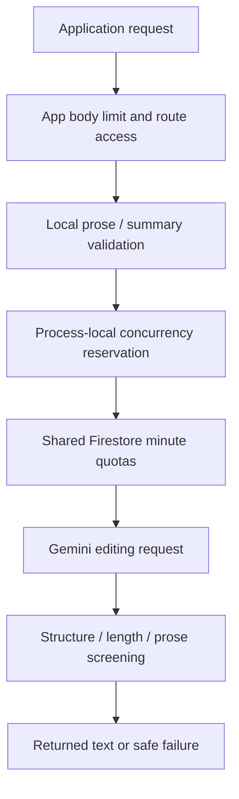

# Assist

## What this feature does

Let's imagine writing a note about a broken sidewalk. A writing helper can polish its spelling, make the whole note easier to follow, or turn its main idea into a shorter message. Assist provides those three choices without asking the writer to start over.

The [OpenAPI definition](../src/docs/swagger.ts) owns the grammar, clarity, and summarization HTTP contracts. Comments explain responsibilities and validation, not a duplicate contract.

## System view

## Responsibilities

- [Model](../src/models/assist.ts): Unicode-aware input checks, heuristic executable-content screening, abbreviation-aware sentence splitting, summary defaults, and returned-summary constraint checks. No submitted text is executed.
- [Routes](../src/routes/assistRoutes.ts): required application access with optional user identity. The [app](../src/app.ts) installs the bounded Assist JSON parser before the handlers; production application access also checks App Check.
- [Controller](../src/controllers/assistController.ts): mode selection, local concurrency, quota charging, early-close cancellation, and cleanup/error translation.
- [Service](../src/services/assistService.ts): shared Firestore quota accounting, fixed provider configuration, distinct editing instructions, and returned-output screening.

## Request lifecycle

Validation happens before quota charging. Grammar and clarity share prose input checks; summaries add copied defaults and validated options. Input whitespace is preserved rather than silently trimmed. Recognizable code, markup, and unsupported controls are screened, but these heuristics are not a proof of semantic safety.

After configuration/capacity checks, the controller reserves a process-local slot and connects response closure to cancellation. It charges shared quota, calls the selected editing mode, and releases listeners/capacity on every exit. This capacity limit is per process, unlike distributed quota storage.

Quota uses global, hashed-application, and optional hashed-user fixed-minute buckets in one Firestore transaction. Counters are stored, not raw credentials or document text. Modes share the quota collection. Provider failure does not refund usage. A timeout on waiting for the quota transaction does not cancel that transaction; a late commit can still charge the request.

## Provider and output boundaries

The service sends source text as untrusted document data, with no enabled tools or automatic function calls. Grammar asks for minimal corrections; clarity asks for a full rewrite; summary asks for structured sentences. Instruction preservation, fidelity, reading level, and brevity are model-directed goals, not all mechanically provable properties.

Provider transport and caller cancellation share a deadline. Safe application errors distinguish unavailable service, timeout, rejection, and invalid output. The response must contain one complete candidate and expected text-only structure before parsing. Truncated, malformed, oversized, or code-like returned content is rejected rather than partially served.

Summary limits count Unicode code points. Maximum sentence/character counts are hard checks, while target sentence count is a goal, not a minimum. The requested grammatical type controls the final sentence. The validator checks structural labels and certain punctuation, not full linguistic correctness or faithfulness.

## Setup and evidence

Existing Gemini and quota-database/limit settings are described in the [README](../README.md). No new variables, roles, or providers are added by this documentation. Documentation generation needs no API key or live Gemini request.

[Assist tests](../tests/assist.test.ts) exercise request validation, provider/output handling, quotas, and controller behavior with mocks. Live evaluations are opt-in and must stay disabled during documentation verification. These tests do not guarantee real model answers preserve every fact or that every malicious-looking document will be recognized.
