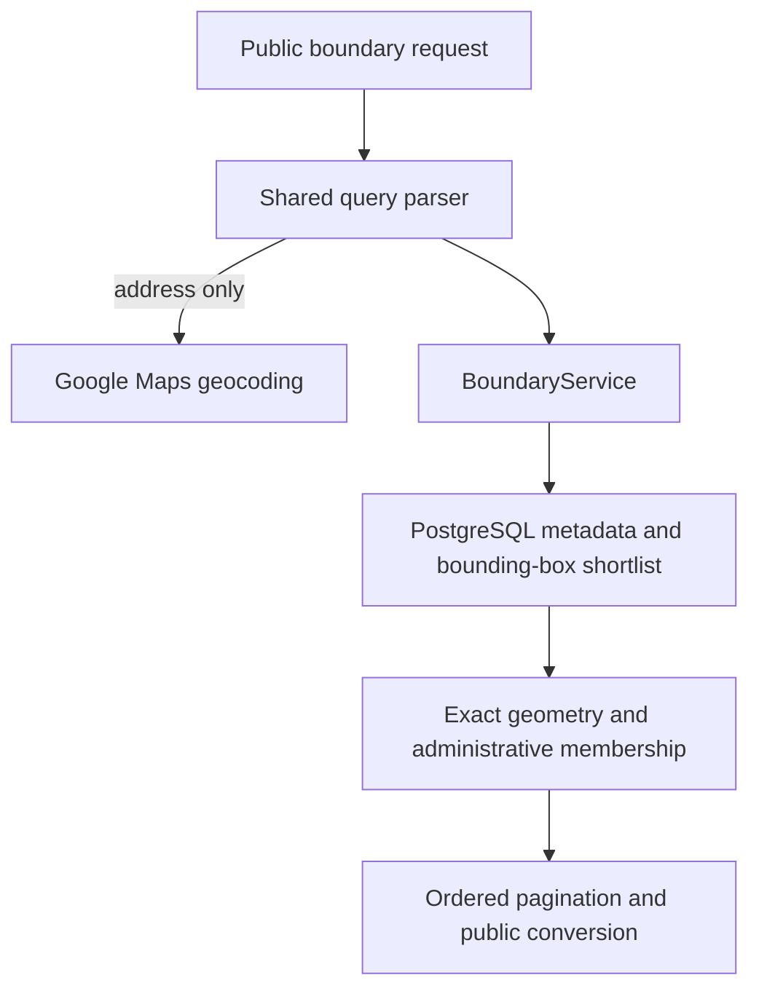

# Boundaries

## What this feature does

Let's imagine finding which council district, school district, and neighborhood group serve your home. Boundaries describe those areas so the map can connect a place with the public bodies responsible for it.

The feature reads stored jurisdiction metadata and geometry. [Boundary synchronization](boundary-synchronization.md) refreshes that data separately. The HTTP authority is the [boundary OpenAPI fragment](../src/docs/boundaries.ts), assembled into [Swagger](../src/docs/swagger.ts); this guide does not duplicate its parameter or response tables.

## System view

## Responsibilities

- [Model](../src/models/boundary.ts): geometry types, storage/public shapes, Dallas calendar dates, and conversion. It performs no network or database operations.
- [Query parser](../src/utils/boundaryQuery.ts): validates single-valued filters, paired coordinates, date and pagination choices. Coordinates take precedence over address lookup; geocoding fills only missing administrative hints.
- [Service](../src/services/boundaryService.ts): parameterized SQL shortlist, exact membership, and Google Maps address resolution.
- [Controller](../src/controllers/boundariesController.ts) and [router](../src/routes/boundariesRoutes.ts): public search/detail orchestration and safe errors, mounted under `/api` by the [app](../src/app.ts).

## Membership and dates

Search combines supplied entity/body/district filters with administrative and spatial rules. SQL filters effective windows and uses generated bounding boxes; exact JavaScript checks run before pagination. The SQL query can retrieve more records than the final page.

- Polygon membership counts an outer edge but excludes holes, including their edges. A MultiPolygon matches any component.
- Administrative arrays accept any matching value within a populated array. Applicable populated fields must agree together.
- An intentionally null shape requires administrative evidence for location membership: missing required metadata cannot prove membership, and no rules cannot establish it.
- `shapePending` distinguishes unknown geometry from intentionally address-only membership. Pending geometry cannot satisfy a location query.
- Without a location request, metadata searches may still return records with pending or null geometry.

Search defaults to today's calendar date in Dallas. Effective dates are inclusive and expiration dates exclusive. Detail reads can return historical/future boundaries; their `isInEffect` flag describes today. Calendar dates are not interchangeable with timestamp instants.

## Address lookup and failure behavior

Address lookup needs `GOOGLE_MAPS_API_KEY`, uses the first result, and returns coordinates plus place hints. Missing configuration, no match, and provider failures are distinguished; they are not silently treated as empty boundary matches. Coordinate-only input may lack administrative facts needed by a null-shape boundary.

These are read operations: they do not enqueue refreshes. Tick operations are intentionally separate and must not be confused with read caching.

## Evidence and limits

[Boundary tests](../tests/boundaries.test.ts) exercise dates, polygon holes, null/pending shapes, normalized administrative rules, parsing, pagination, and synchronization using test infrastructure. [Migration tests](../tests/boundaryMigration.test.ts) cover database structure. These checks do not establish that current external geocoding or GIS sources are available.

See [representative search](representatives.md) for reuse of the same geography and [README setup](../README.md) for migrations and configuration. The generated code reference documents the selected implementation; seed-data generation is not expanded by this backfill.
