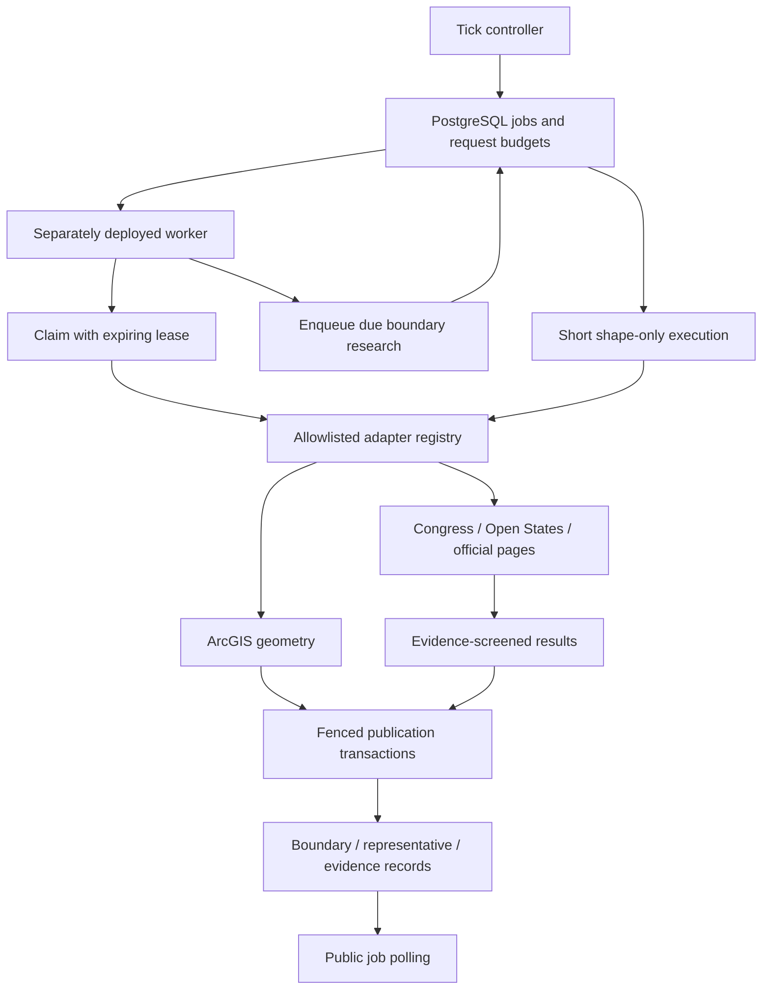

# Boundary synchronization

## What this feature does

Let's imagine a helper regularly checking whether a district map or a public address book has changed. This feature keeps a shared to-do list for those checks, so work can continue even after the original visitor leaves.

It refreshes boundary geometry and researched jurisdiction/representative facts. Public ticks ask for due work; staff force requests can bypass freshness checks. [OpenAPI](../src/docs/boundaries.ts) owns paths, authentication, and response contracts.

## System view

## Scheduling and request behavior

The [tick router](../src/routes/boundaryTickRoutes.ts) rejects non-polling HEAD/prefetch triggers and applies no-store headers. Forced requests use application access, production App Check, and canonical staff authorization. The [controller](../src/controllers/boundariesController.ts) can complete short shape-only work inline; research is durable worker work. A completed poll includes the current target model, not the model as it existed at job completion.

The [sync service](../src/services/boundarySyncService.ts) maintains one active job per boundary scope, including representative jobs sharing that boundary. Ordinary ticks reuse active work; a conflicting force request fails instead of overlapping. If a reused job belongs to a different requested target in the scope, the controller returns that target's current model.

Automatic selection considers effective boundaries and due work. Explicit identifiers can inspect/synchronize records outside their effective window. Null descriptors provide no refresh work. Freshness is measured from successful sync, not the last attempt, and retry backoff blocks immediate repeated failures.

Client-address budgets are hashed and committed before the selection transaction. Claiming consumes distributed global budgets and respects a shared concurrency ceiling. Changing the caller's HTTP lifetime does not remove a queued task.

## Leases and publication

Claims carry expiring lease tokens. Publishing transactions verify the token and lease so stale workers cannot overwrite newer work. Expired jobs can be reclaimed; exhausted crash attempts become failures with backoff.

Shape and research phases commit separately. Successful shape progress remains if subsequent research fails. Short inline deadlines requeue without charging a crash attempt; other recorded failures retain good data and apply retry backoff. Failure-recording database errors can still propagate rather than producing a normal outcome.

Research updates preserve omitted fields. Retirement of absent officeholders requires an authoritative, complete, nonempty roster, with additional targeted-person safeguards. Unresolved proposals/evidence are retained for review rather than treated as verified replacements. Empty or partial results must not be interpreted as proof every incumbent has departed.

Official research actively collects published professional emails and phones, including contacts on separate official pages, link-only `mailto:`/`tel:` values, public Cloudflare-protected email links, footers, and PDFs. It follows at most six approved links across two levels, prioritizing contact pages and PDFs; optional discovery search and all existing host, byte, deadline, and cancellation limits still apply. Model input retains both the beginning and end of long pages so trailing contact sections remain available.

Each proposed contact carries its owner, category (`direct`, `shared_office`, or `staff`), an exact source quote containing the owner and value, and a separate exact quote connecting that owner to the representative or jurisdiction. Both quotes must occur in retrieved approved documents. Unrelated offices, conflicting district references, invented values, and unapproved evidence are rejected. Direct contacts must name the representative; shared and staff contacts are labeled explicitly and include routing guidance. General organization inboxes are never labeled as personal email addresses, and SMS capability is not inferred. Raw proposals and source URLs remain in research evidence for review.

Verified contacts merge into an existing person's saved contact arrays, deduplicated by email or phone; a newly verified value refreshes its label and guidance. Missing or rejected contacts preserve previous data, and an empty search does not clear contacts. This deliberately does not remove stale contact values automatically. Scheduled research uses this same path without manual hydration; fresh records are enriched on their next due run, or through the existing staff force-sync mechanism. Deploy the updated worker image to enable the behavior in Cloud Run.

## Adapter boundaries

- [Registry](../src/services/boundaryAdapters.ts): explicit file/function allowlist and provider-key preflight, never arbitrary imports.
- [ArcGIS](../src/services/shapes/arcgis.ts): paged polygon retrieval, structural/range checks, and source identity matching; not topology repair.
- [Congress](../src/services/research/congress.ts) and [Open States](../src/services/research/openStates.ts): current-term/district filtering and strict roster-size checks.
- [Official research](../src/services/research/official.ts): bounded approved documents, optional discovery search, and exact normalized evidence checks. Contact evidence is checked separately from person identity. Complete-roster classification is conservative for singleton offices.
- [HTTP helper](../src/services/boundaryHttp.ts): bounded responses and explicitly approved redirects. Initial host policy belongs to callers; host syntax/allowlists do not prove DNS resolves to public addresses.
- [Shared research types](../src/services/research/types.ts): publishable people, completeness, provenance, and unresolved proposals.

## Worker and setup

The [worker entrypoint](../src/scripts/boundaryWorker.ts) is a separate process, not started by HTTP ticks. It requires migrated PostgreSQL tables and `BOUNDARY_SYNC_ENABLED=true`. Before processing the queue, it calls `BoundarySyncService.enqueueDueResearch` to discover current boundaries with due research adapters. This hydrates missing representative records and refreshes existing ones through the same verified research/persistence path. It does not automatically enqueue shape work or force fresh records to refresh.

Discovery reads keyset pages of 100, queues up to `BOUNDARY_SYNC_RESEARCH_ENQUEUE_LIMIT` new jobs per scan (default 100, allowed 1–10000), and skips future/expired boundaries, fresh research, retry backoff, null adapters, and any boundary scope with a queued/running job. It shares the public tick selection lock and active-scope uniqueness constraint. Missing provider keys and unapproved adapters are logged and skipped without preventing other providers from running. Trusted worker discovery does not consume HTTP-client budgets; claims retain the distributed minute/day execution budgets and concurrency limit.

The [worker loop](../src/services/boundaryWorkerService.ts) rescans once per minute while running, claims and executes tasks, and the entrypoint closes the pool on exit. `--once` exits at an idle/claim-error pass after draining available work. Discovery failures still allow existing queued jobs to run; discovery, claim, or execution failures produce a nonzero exit code. Logs include `boundary_research_enqueued` counts and per-boundary `boundary_research_enqueue_skipped` codes. Capacity, provider availability and execution budgets can leave work queued for later scheduled runs. A separate discovery scheduler is no longer required for boundary research; explicit ticks remain available.

Follow the [deployment runbook](boundary-sync-deployment.md) for Bash commands covering provider secrets, a scheduled Cloud Run Job, IAM, smoke tests, and production enablement. The [README](../README.md) retains migration, source-registry, and concurrency/budget context. Starting a worker, applying seeds/migrations, or contacting a provider is not necessary to generate documentation.

## Evidence and limits

[Boundary tests](../tests/boundaries.test.ts) cover queued/inline work, deduplication, stale leases, partial roster protections, force authorization, budgets, and deadlines. [Worker research tests](../tests/boundaryWorkerResearch.test.ts) cover discovery filters/pagination, active-scope deduplication, bounded scans, budget enforcement, initial hydration and stale-record refresh. [Adapter tests](../tests/boundaryAdapters.test.ts) and [worker configuration tests](../tests/boundaryWorkerConfig.test.ts) cover additional provider/configuration paths. [Concurrency tests](../tests/boundaryConcurrency.test.ts) require an opt-in real PostgreSQL connection; local test doubles do not prove production locking or provider availability.
