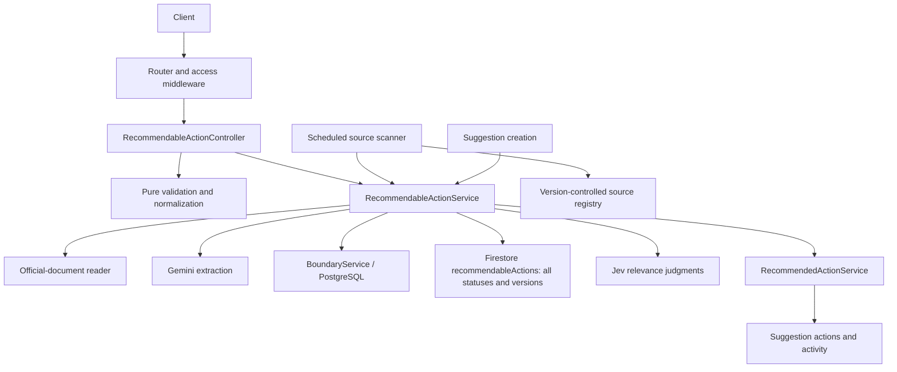

# Recommendable Actions: documentation pilot

## Purpose and scope

A **Recommendable Action** is a reusable, source-backed civic next step. A **Recommended Action** is an action attached to one suggestion. The catalog and the suggestion's action history are separate: reviewing or closing a catalog entry does not rewrite existing suggestion actions.

This pilot documents the reusable-action [model](../src/models/recommendableAction.ts), [controller](../src/controllers/recommendableActionController.ts), [service](../src/services/recommendableActionService.ts), and [router](../src/routes/recommendableActionRoutes.ts). Worker and suggestion integration are described as context, not a repository-wide comment backfill.

See [documentation conventions](documentation-conventions.md) for ownership rules. The [OpenAPI definition](../src/docs/swagger.ts) remains the HTTP contract for the `/api/recommendables` route family; this page intentionally does not reproduce its payloads, response tables, or authentication matrix.

## System view



This is a responsibility/dependency map, not a call sequence: different service methods use different dependencies.

## Responsibilities and entry points

| Layer | Role |
| --- | --- |
| [App](../src/app.ts) and [router](../src/routes/recommendableActionRoutes.ts) | Mount the feature and apply API-key, user, and staff access policies before controllers. |
| [Controller](../src/controllers/recommendableActionController.ts) | Validate HTTP-level choices, coordinate extraction and model validation, adapt results/errors, and cancel extraction if the response closes early. |
| [Model](../src/models/recommendableAction.ts) | Define domain shapes, normalize candidate content without I/O, and express any-overlap geographic scope. |
| [Service](../src/services/recommendableActionService.ts) | Retrieve/extract evidence, check boundary references, persist review/catalog state, version publications, and match suggestions. |
| [Source scanner](../src/scripts/recommendableWorker.ts) | Detect changed registry pages and propose candidates; never auto-publish them. |
| [Dallas 311 seed script](../src/scripts/seedDallas311Recommendables.ts) | Build one or more stable review candidates per service type; apply only after a citywide Dallas boundary is seeded. |
| [Suggestion controller](../src/controllers/suggestionController.ts) | Save a suggestion, attempt matching, and preserve submission success if matching fails. |

## Workflows and invariants

The approved catalog is publicly readable without an API key through `GET /api/recommendables`; an optional `search` query performs case-insensitive substring matching across summary, instructions, why, and whyNot. `GET /api/recommendables/:id` returns an entry only while it is approved. The collection response remains bounded to 500 entries.

### Submission and extraction

Actions expose `photos: string[]`, with `[]` when none are attached. Submission accepts an optional `photos` array of HTTP/HTTPS URLs; the validator trims and deduplicates URLs and rejects non-URL values and credential-bearing URLs. Older inputs may omit the field, and legacy stored records read as `[]`. Generic text extraction does not invent image URLs.

1. The controller checks the submission shape and connects response closure to an abort signal.
2. The service accepts City of Dallas hosts, retrieves the source through the [official-document reader](../src/services/research/official.ts), and checks the final host.
3. Gemini proposes structured action content. The service requires nonempty action text and supporting evidence that occurs in the retrieved text after whitespace/case normalization. Textual support is not a guarantee that every generated claim is correct.
4. The controller combines the proposal with submitted boundaries and runs model validation. The validator rejects invalid shapes/fields, trims text, serializes the URL, and deduplicates/sorts boundary IDs without mutating input. It does not retrieve URLs or prove network safety.
5. Candidate creation checks boundary existence and writes to `recommendableActions` with status `candidate`. Every lifecycle status uses this collection; only approved records are public and eligible for matching.

The worker is a separate caller: it prepares candidate content directly rather than invoking the controller's model-validation path.

### Review and versioning

- Candidate listing includes reviewed records and returns up to the 500 newest; it is not a pending-only queue or a paginated feed.
- Approval and rejection update the same action document and save version snapshots atomically. Rejection makes that action ineligible for matching.
- A registry or seed `sourceKey`, when present, is the stable document ID. Otherwise the supplied/generated action ID is used. Approval never copies a document into a second collection.
- Approval rechecks boundaries; a transaction rejects concurrent content changes. Repeating the same review decision returns the current record without adding a version.
- Changed source fingerprints update the same action and return it to candidate status; there is no separately published copy while the changed content awaits review. Unchanged source fingerprints preserve status.
- Catalog status updates create a new version even when the requested status equals the existing status. Only approved catalog entries participate in matching.

### Playground and read-only matching

Open `/playground/recommendables` from the home page to test unstructured text without creating a suggestion or saving results. Address mode is selected initially with `1902 Main St, Dallas, TX 75201` (Main Street Garden Park), using coordinates `32.781162`, `-96.794861` from the supplied map location. Switch to coordinates to edit them, or clear location to test unrestricted actions only. Public access requires no login or API key.

`POST /api/recommendables/match` accepts `{ text, latitude?, longitude? }`. Text must be nonblank and at most 10,000 characters; coordinates must be supplied together within geographic ranges. The OpenAPI definition owns the complete request and response contract.

`RecommendableActionService.findMatches` reads all approved catalog entries through pagination, resolves all applicable boundaries, and keeps unrestricted actions plus those sharing any resolved boundary. It asks JEV independent relevance questions in batches of 40, with at most three requests in flight. It returns accepted catalog entries with match probabilities, sorted by descending probability then ID, plus catalog/eligible counts, threshold, and boundary IDs/names. The public catalog listing remains bounded to 500; matching does not use that limit.

The threshold comes from `RECOMMENDABLE_MATCH_THRESHOLD` (default `0.9`); credentials and model use `TYPESAFE_API_KEY` and `TYPESAFE_MODEL` (default `jev-latest`). JEV calls time out after 20 seconds and a full run after 120 seconds. Disconnecting cancels outstanding work. Invalid/missing relevance answers or dependency failures fail the run without returning partial matches. Pairwise comparison failures use the fallback described below.

After relevance scoring, actions strictly above 20% compete in descending score order, with catalog ID breaking ties. For each surviving action, JEV answers the independent `noul` question “Would these actions lead the resident to take the same practical next step for this description?” against each remaining lower-ranked action. It receives the original description and both actions' summary, instructions, why and why-not text. Redundancy means the same practical action for this issue, including the same reporting route or request type despite wording differences; a shared website or department alone does not establish redundancy. Complementary steps (such as emergency dispatch and contacting a gas utility) and materially different outcomes remain. A probability strictly greater than 90% removes the lower-scoring action, even if it is more specific. Removed actions never participate in subsequent matchups. Comparisons within each survivor's round are batched by 40 with at most three concurrent calls.

This filtering applies to both playground results and saved suggestion recommendations, before the acceptance threshold and any persistence. `eligibleActions` contains the remaining actions, while `diagnostics.eligibleCount` still counts geographic eligibility before redundancy filtering. Missing, invalid, failed, or timed-out comparison answers retain both actions and are not cached; caller cancellation and the overall deadline still abort the run. Successful pair judgments (including non-redundancy) are cached per process for one hour, using a hash of the normalized description, rounded coordinates, both actions' IDs and classification text, configured model, and comparison policy version (`same-practical-next-step-v2`). Old encapsulation judgments cannot be reused. The cache holds at most 10,000 pairs. Raw relevance scores remain separately cached so failed comparisons can be retried.

The API's `diagnostics` includes the configured model, total duration, relevance duration/cache hit/request count, and a `comparisons` report. That report includes the question and policy, exclusive thresholds, duration, candidate/pair counts, cache hits, network requests, failed pairs and removals. Candidate snapshots preserve classification text and original relevance scores, including removed actions. Each pair records action IDs (higher-ranked first), redundancy probability or null, cache hit, decision (`keep_both`, `remove_lower`, `keep_on_failure`), removed ID when applicable, and sanitized failure code (`timeout`, `network`, `http`, `malformed_response`, `invalid_answer`). Pair records follow deterministic matchup order regardless of response completion order. Runs without necessary comparisons still return a report with zero pairs/requests/failures/removals. Diagnostics are response-only; there is no diagnostic UI or persisted report.

The playground displays action content, source links, probabilities, and geographic diagnostics. Nothing from a test is persisted.

### Suggestion matching

`matchSuggestion` wraps read-only classification for saved suggestions, combining their summary and details as input text. It skips catalog links already attached and delegates new matches to RecommendedActionService using deterministic IDs. Its return array contains only newly attached catalog entries.

Classification completes before linked actions are written. Persistence remains incremental rather than atomic across matches. The suggestion controller catches matching failures after saving the suggestion, so submission remains available.

### Scheduled discovery

The [scanner](../src/scripts/recommendableWorker.ts) reads the [source registry](../src/data/recommendableSources.ts), compares content fingerprints, and skips unchanged pages. Changed pages update the action at the stable source key transactionally, save its previous version, and return it to candidate status.

When extraction reports no verifiable opportunity, the scanner attempts to mark the associated catalog entry uncertain and stores the new source fingerprint. Other failures are logged per source. In production, the `recommendable-worker` Cloud Run Job runs `dist/scripts/recommendableWorker.js` once daily at midnight America/Chicago, triggered by the `recommendable-worker-daily` Cloud Scheduler job. It uses the API runtime identity and the public-improvements Firestore database; the job image is independently deployed and does not automatically follow later API revisions.

### Dallas 311 one-time seed

The [boundary seed generator](../src/scripts/seedBoundaries.ts) includes a citywide `City of Dallas` record using the official City Limits GIS layer. Generate a city-only SQL seed with `npm run seed:boundaries -- --city-limits-only --output <new-file.sql>`, then apply that reviewed file with `npm run seed:boundaries -- --sql-file <file.sql> --apply`.

The [311 candidate generator](../src/scripts/seedDallas311Recommendables.ts) now converts the enriched `actions` arrays in `data/311`, rather than regenerating routes from the older 279-type catalog. The checked-in [mapping](../data/dallas311-seed-mapping.json) assigns permanent member identities, canonical group keys, evidence pointers, and explicit merge decisions. The initial [manifest](../data/dallas311-seed-manifest.json) accounts for 368 source actions in 365 groups: 198 eligible drafts and 167 held groups. The two test records and `.bak` files are excluded. Only equivalent hazardous-pothole and hazardous-guardrail phone actions are merged initially; other equivalences require explicit mapping review.

Generation is offline and does not load database clients:

```sh
npm run seed:dallas311-recommendables -- --output data/my-311-review.json
```

Use `--force` only to intentionally replace an existing draft. The manifest preserves source action snapshots (including null exclusions), file and observation hashes, JSON pointers, dispositions, scenario-specific exclusions, and consolidation decisions. Candidate text maps the saved tagline, formatted directions, purpose, and exclusions into the existing model. A null captured `why_not` becomes `whyNot: ""`; merged actions omit empty scenario exclusions and retain the numbering of real exclusions. Instructions incorporate the recipient naturally in the directions, end sentences with punctuation, and format portal menu paths as numbered steps; they do not append a recipient label. Captured links, addresses and route conditions are preserved. Supporting evidence contains captured source text, never generated action prose. Oversized fields are held without truncation. Staff-question holds conservatively cover an entire cited record and propagate through evidence references and merges; a record citation does not prove every action in that record is wrong. Resolve the unanswered question and update the questions document before regenerating those groups.

Review the six `pilotKeys` using the [pilot notes](dallas311-seed-pilot.md), including the held example. Add only the five eligible pilot keys to `review.approvedKeys`. This is seed-content review, separate from staff catalog approval. After the Dallas boundary exists, import that selected artifact:

```sh
npm run seed:dallas311-recommendables -- --apply --manifest data/my-311-review.json --pilot --report data/my-311-pilot-import.json
```

Review the persisted pilot candidates, set `review.pilotReviewed` to `true`, and expand `review.approvedKeys` to the remaining eligible groups you have reviewed. Import with a fresh report filename:

To preserve separately approved pilot edits, select only the remaining group keys in `review.approvedKeys`. Excluded pilots may satisfy the pilot prerequisite through their existing approved status even if their fingerprints differ from the draft. They are not written by that import; selected pilots still use revision matching and may be returned to candidate status if their content differs.

```sh
npm run seed:dallas311-recommendables -- --apply --manifest data/my-311-review.json --report data/my-311-import.json
```

Import reads the chosen manifest without regenerating candidate wording. It validates provenance, source drift, coverage, unresolved holds, and all eligible payloads, requires exactly one active Dallas citywide boundary with a shape, then checks action count and identity collisions before the first write. It refuses imports that would exceed the 500-record action listing limit. Coordinate imports serially because capacity preflight is not a cross-process reservation. Production collection sizes and legacy overlaps are checked at import time, not during offline generation.

The report lists created, updated, retained, held, skipped, failed, and overlapping legacy records. The importer transactionally upserts each action at its stable source key. An unchanged fingerprint retains the existing status; changed content saves version history and resets the same action to candidate status. Partial failures return a nonzero exit code; rerun the same manifest with a new report path to resume. Successful import only creates review candidates; publication still uses the normal staff approval endpoint. Review legacy overlaps in the report before publication; no older entry is automatically closed.

Canonical keys and member UUIDs are assigned in the mapping and must remain stable when wording changes. If a saved action changes, update its `actionHash` and evidence pointers after review while retaining its member ID and group key; then generate a new manifest. Changes in content or provenance produce a new fingerprint and seed revision token in the manifest; the database document ID remains the same `sourceKey`. Revision tokens are not separate draft document IDs. Snapshot pointers record current array positions for tracing; array positions do not define identity. The `/candidates` API paths remain compatibility routes for creating, listing, and reviewing actions; they do not identify a separate collection. Any inventory, mapping, or questions-document change invalidates an older artifact. Editing review selections does not change candidate revision IDs. For editorial changes directly in a manifest, recalculate the changed entry's fingerprint with the exported `entryFingerprint` and `candidateId` helpers; evidence and provenance remain immutable.

## Configuration and operational context

Existing setup instructions and environment-variable details remain in the [README](../README.md). The service uses Firestore for review/catalog state, PostgreSQL through BoundaryService, Gemini for extraction, and TypeSafe/Jev for matching. This documentation change adds no variables, roles, endpoints, or dependencies.

## Verification and next step

[Recommended Actions tests](../tests/recommendedActions.test.ts) cover model normalization and geographic applicability alongside suggestion-action behavior. They do not establish end-to-end correctness of extraction, review transactions, discovery, or external relevance services.

The approved pilot's comments feed TypeDoc-generated Markdown reference rendered directly inside the [developer portal](index.md), sharing its theme, navigation, layout, and search. The portal renders this overview's Mermaid diagram graphically, with light/dark themes and an expandable source view. Generate the unified site with `npm run docs:build`; this does not change executable API behavior or OpenAPI. This feature remains the four-module pilot; the shared reference also includes the [additional selected features](index.md#feature-guides). The [Documentation workflow](index.md#automated-checks) validates the unified build on Ubuntu and Windows. Broader backfill, required-check branch rules, and publication remain separate follow-up steps.

## Consolidating legacy review collections

### Captured 311 photos

New 311 manifests populate `input.photos` from each action's saved source record `photoUrls`; merged actions use the deduplicated union of their member records. Photos are source-page illustrations, not photos submitted by a resident or evidence that a particular incident occurred. No images are fetched or generated. Older manifests without the field remain readable.

Run `npm run backfill:recommendable-photos -- --project urbanists-mixer-slides-helper --database public-improvements --report data/photo-preview.json` to preview enrichment of existing candidate and approved actions. Add `--apply` with a new report filename to write. The report preserves full pre-change records. Existing attachments are retained; captured images are appended without duplicates, and records without captured or attached images receive `[]`. Each changed action gets a version snapshot and increment while its status, text, boundaries and seed fingerprint remain unchanged. Concurrent edits are reported rather than overwritten. Held groups are not imported by this command, and other lifecycle statuses are untouched.

### Collection migration

`npm run migrate:recommendable-actions -- --project urbanists-mixer-slides-helper --database public-improvements --report data/recommendables-migration-preview.json` previews the one-time consolidation and writes a source-data backup. Add `--apply` with a fresh report path to apply it. The migration maps each source-backed record to its stable source key in `recommendableActions`, preserves every field and status, checks all source/target records again inside one atomic transaction, and verifies the result. Conflicting target data and legacy subcollections stop the migration without deleting source data. Repeating the migration after success is a no-op. The migration is limited to 200 legacy records per run; larger datasets require pagination.

Deploy the updated API and scanner together with this data migration: older runtime images still target the obsolete collection and can recreate it. This repository change does not deploy unrelated local changes automatically.

The playground’s “Show low matches (20% to 50% probability)” toggle reveals actions from 20% to below 50%, ordered by descending JEV probability. It switches the displayed results immediately without another model request. The matching response exposes `eligibleActions` for this inspection; `data` and `count` continue to represent accepted matches only.

Playground cards use fixed visual score bands: primary at 80% or higher, secondary from 50% to below 80%, and tertiary from 20% to below 50%. Scores below 20% stay hidden. Primary and secondary cards appear by default; the checkbox reveals tertiary cards. These display bands do not change the server-configured acceptance threshold or saved-suggestion matching.

The low-match checkbox appears only when results include scores from 20% to below 50%, after higher-scoring cards and before low-scoring cards. The “Boundary results” table follows all cards. Its Representative column shows each bold name/title above boundary breadcrumbs; the Contact column groups phone/email entries by contact label and displays only the longest contact reason per group. Duplicate representative name/title rows share one entry with all applicable breadcrumbs. Representative reads are paginated and do not trigger research or persistence. “No current representative on file” means the directory has no current record for that boundary, not that nobody represents it. Research requires a configured adapter, due-work enqueueing and the separately enabled [boundary worker](boundary-synchronization.md).

The page is titled “Search Actions & Representatives.” Its description textarea expands as users type or choose a sample. The attached full-width toolbar provides Randomize and a searchable sample dialog. A location toggle switches between editable Dallas-default coordinates and address autocomplete. Both modes share current-location and clear-location buttons; clearing omits coordinates from matching and selects unrestricted actions only. Geolocation permission, timeout and unavailable-browser errors leave the form usable. Stale location callbacks cannot restore a cleared or changed selection.

Address autocomplete uses the server-side Google Places API (New) proxy, a 250 ms debounce, a three-character minimum, cancellable requests and session tokens shared with place details. A Dallas bias suggests nearby addresses without restricting other locations. Selecting a prediction sets numeric coordinates; editing an address clears its previous coordinates and requires a new selection. Set `GOOGLE_MAPS_API_KEY` and enable Places API (New); the existing directory geocoder separately requires Geocoding API. Keys stay server-side. Google Maps attribution accompanies predictions and selected Google addresses. See [Google's autocomplete documentation](https://developers.google.com/maps/documentation/places/web-service/place-autocomplete).

The full-width Search button is disabled for an empty description. Searching disables the entire form, displays a spinner with an accessible label, then restores controls and inputs on completion. “Recommended actions” appears only when action cards are visible; empty and error status messages remain available without that heading. The page omits the API header, introductory paragraph, location-help sentence, and documentation footer.

## JEV score cache

Successful JEV judgments are cached per server process for one hour after completion. The SHA-256 lookup key contains the description converted to uppercase with all characters outside `A–Z` and `0–9` removed, plus latitude/longitude rounded to four decimal places (or nulls when omitted). Normalization affects only the cache key; JEV receives the original description on a miss.

Every request still reads the current approved catalog and geography. A separate fingerprint covers the selected model and every eligible action’s ID, summary, instructions, why, and why-not text. Changes to classification content or eligibility invalidate cached scores, including additions, removals, and approval changes. Cached scores are combined with current action records, photos, representative contacts, and the current acceptance threshold. Failures, cancellations, and partial results are not cached. LRU eviction limits retained entries to 128 and an 8 MiB serialized score budget; restarts or eviction may remove entries before expiry.

The playground's unchecked “Run without JEV cache” checkbox lives under the collapsed “Testing options” dropdown in the description toolbar and submits the optional boolean `bypassJevCache` (default false). A fresh run neither reads nor updates either JEV cache, so it does not overwrite previously cached scores or judgments. Boundary caching is unaffected. For debugging, inspect the match response's diagnostics in browser network tools or an API client: distinguish a redundancy score at or below 90% from `keep_on_failure` and check cache hits before interpreting repeated outcomes. Automated fixtures verify the workflow; they do not guarantee a particular live model judgment.

“Use default (downtown)” restores `1902 Main St, Dallas, TX 75201` and coordinates `32.781162`, `-96.794861` in either location mode and cancels pending location selection. Cards retain their score-based color styles but display only “XX% match”. A nonblank exclusion displays bold “Why:” and “Why not:” labels; without an exclusion, only the reason text appears. The separate source link is omitted when the sanitized instructions already link to the same URL (ignoring fragments).
