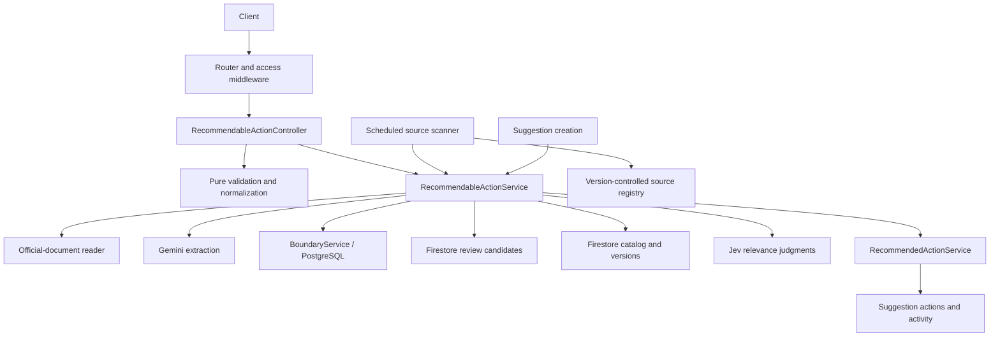

# Recommendable Actions: documentation pilot

## Purpose and scope

A **Recommendable Action** is a reusable, source-backed civic next step. A **Recommended Action** is an action attached to one suggestion. The catalog and the suggestion's action history are separate: reviewing or closing a catalog entry does not rewrite existing suggestion actions.

This pilot documents the reusable-action [model](../src/models/recommendableAction.ts), [controller](../src/controllers/recommendableActionController.ts), [service](../src/services/recommendableActionService.ts), and [router](../src/routes/recommendableActionRoutes.ts). Worker and suggestion integration are described as context, not a repository-wide comment backfill.

See [documentation conventions](documentation-conventions.md) for ownership rules. The [OpenAPI definition](../src/docs/swagger.ts) remains the HTTP contract for the `/api/recommendables` route family; this page intentionally does not reproduce its payloads, response tables, or authentication matrix.

## System view

This is a responsibility/dependency map, not a call sequence: different service methods use different dependencies.

## Responsibilities and entry points

| Layer | Role |
| --- | --- |
| [App](../src/app.ts) and [router](../src/routes/recommendableActionRoutes.ts) | Mount the feature and apply API-key, user, and staff access policies before controllers. |
| [Controller](../src/controllers/recommendableActionController.ts) | Validate HTTP-level choices, coordinate extraction and model validation, adapt results/errors, and cancel extraction if the response closes early. |
| [Model](../src/models/recommendableAction.ts) | Define domain shapes, normalize candidate content without I/O, and express any-overlap geographic scope. |
| [Service](../src/services/recommendableActionService.ts) | Retrieve/extract evidence, check boundary references, persist review/catalog state, version publications, and match suggestions. |
| [Source scanner](../src/scripts/recommendableWorker.ts) | Detect changed registry pages and propose candidates; never auto-publish them. |
| [Suggestion controller](../src/controllers/suggestionController.ts) | Save a suggestion, attempt matching, and preserve submission success if matching fails. |

## Workflows and invariants

### Submission and extraction

1. The controller checks the submission shape and connects response closure to an abort signal.
2. The service accepts City of Dallas hosts, retrieves the source through the [official-document reader](../src/services/research/official.ts), and checks the final host.
3. Gemini proposes structured action content. The service requires nonempty action text and supporting evidence that occurs in the retrieved text after whitespace/case normalization. Textual support is not a guarantee that every generated claim is correct.
4. The controller combines the proposal with submitted boundaries and runs model validation. The validator rejects invalid shapes/fields, trims text, serializes the URL, and deduplicates/sorts boundary IDs without mutating input. It does not retrieve URLs or prove network safety.
5. Candidate creation checks boundary existence and writes to `recommendableActionCandidates`. It does not publish the action.

The worker is a separate caller: it prepares candidate content directly rather than invoking the controller's model-validation path.

### Review and versioning

- Candidate listing includes reviewed records; it is not a pending-only queue.
- Rejection changes the candidate only. It does not retract an existing catalog entry.
- Approval rechecks boundaries and publishes to `recommendableActions`. A registry `sourceKey`, when present, is the stable catalog identity; otherwise the candidate ID is used.
- The catalog write, its `versions` snapshot, and the candidate's approved state are written in one transaction. The initial candidate read is outside that transaction; it is not a concurrent-review lock.
- Reapproving an already-approved candidate returns the current catalog entry when available.
- Catalog status updates create a new version even when the requested status equals the existing status. Only approved catalog entries participate in matching.

### Suggestion matching

1. Read the bounded approved catalog and resolve suggestion coordinates to boundary IDs when available.
2. Keep globally scoped entries (empty boundaries) and restricted entries with any shared boundary ID. A restricted entry cannot match when no suggestion boundaries resolve.
3. Ask Jev for relevance judgments in batches. Accept finite scores at or above the configured threshold and skip catalog links already attached to the suggestion.
4. Delegate accepted entries to [RecommendedActionService](../src/services/recommendedActionService.ts) using deterministic action IDs and catalog linkage.

Matching persists incrementally rather than atomically across all matches. If a later call fails, earlier actions may already exist. The suggestion controller catches matching failures after saving the suggestion, so submission remains available.

### Scheduled discovery

The [scanner](../src/scripts/recommendableWorker.ts) reads the [source registry](../src/data/recommendableSources.ts), compares content fingerprints, and skips unchanged pages. Changed pages produce stable candidate IDs derived from source identity and fingerprint. A supplied candidate ID avoids overwriting an existing record, but the read-before-create sequence is not an atomic upsert.

When extraction reports no verifiable opportunity, the scanner attempts to mark the associated catalog entry uncertain and stores the new source fingerprint. Other failures are logged per source. Scheduling and deployment are separate from serving HTTP requests.

## Configuration and operational context

Existing setup instructions and environment-variable details remain in the [README](../README.md). The service uses Firestore for review/catalog state, PostgreSQL through BoundaryService, Gemini for extraction, and TypeSafe/Jev for matching. This documentation change adds no variables, roles, endpoints, or dependencies.

## Verification and next step

[Recommended Actions tests](../tests/recommendedActions.test.ts) cover model normalization and geographic applicability alongside suggestion-action behavior. They do not establish end-to-end correctness of extraction, review transactions, discovery, or external relevance services.

The approved pilot's comments feed TypeDoc-generated Markdown reference rendered directly inside the [developer portal](index.md), sharing its theme, navigation, layout, and search. The portal renders this overview's Mermaid diagram graphically, with light/dark themes and an expandable source view. Generate the unified site with `npm run docs:build`; this does not change executable API behavior or OpenAPI. This feature remains the four-module pilot; the shared reference also includes the [additional selected features](index.md#feature-guides). The [Documentation workflow](index.md#automated-checks) validates the unified build on Ubuntu and Windows. Broader backfill, required-check branch rules, and publication remain separate follow-up steps.
