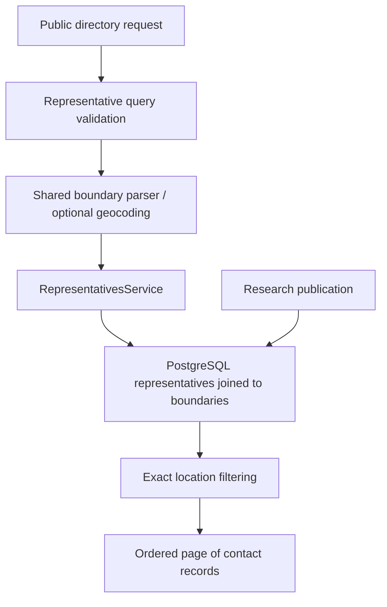

# Representatives

## What this feature does

Let's imagine wanting to ask your council member about a park near home. The directory helps find the public officials who serve your area and brings their contact information together. It can also help look back at who served before.

Representative records belong to shared [boundaries](boundaries.md). [Synchronization](boundary-synchronization.md) refreshes researched facts separately; reading the directory does not trigger that work. [OpenAPI](../src/docs/swagger.ts) owns the public directory and Dallas Council shortcut contracts.

## System view

## Responsibilities

- [Model](../src/models/representative.ts): office/contact information, tenure, election periods, and linked boundary shape.
- [Service](../src/services/representativesService.ts): joined queries, office/date filters, UTC timestamp projection, exact boundary membership, and pagination.
- [Controller](../src/controllers/representativesController.ts): date/identifier validation, geography parsing, shortcut filters, and safe errors.
- [Directory router](../src/routes/representativesRoutes.ts) and [Council router](../src/routes/dallasCityCouncilRoutes.ts): public reads mounted by the [app](../src/app.ts), without API-key or user middleware.

## Search semantics

Supplied filters are combined. Entity/body/district and title compare case-insensitively by exact text. Location hints and geometry reuse boundary rules: coordinates take precedence over an address; an address may supply missing administrative facts; pending/null-shape rules are not equivalent to universal membership.

Without `servingAsOf`, the SQL tenure filter compares the current database timestamp. With a serving date, comparisons are calendar-day based. Representative start/end checks are inclusive. A linked boundary must also be effective on the selected boundary/serving date; boundary expiration is exclusive. An election-period search matches early-voting start through election day, inclusive; it does not prove every aspect of election status.

The nested boundary's derived `isInEffect` describes today, even in a historical search. It should not be interpreted as a second evaluation against the requested historical day.

Exact location filtering happens before pagination. Joined records expose the boundary rather than a separately copied geometry/administrative description on each person. A direct service lookup by identifier does not apply tenure filters and can serve historical records to synchronization.

## Dallas Council shortcut

The shortcut fixes City of Dallas, City Council, and Council member filters while preserving the shared search pipeline. It excludes the mayor by office title rather than maintaining a separate directory. Address failures remain explicit errors, not empty successful results.

## Research and operations

Public lookup does not change the data. Research publication, source evidence, retained history, and conservative incumbent retirement are covered in [Boundary synchronization](boundary-synchronization.md). Existing PostgreSQL migrations, source limitations, and address-provider setup stay in the [README](../README.md).

## Evidence and limits

[Representative tests](../tests/representatives.test.ts) cover public access, combined filters, historical/election dates, geography, and the Council shortcut using controlled data. [Migration tests](../tests/representativesMigration.test.ts) check schema assumptions. These do not verify that live official contact data is current; absent contact fields mean the stored record lacks that information, not that no contact channel exists.
