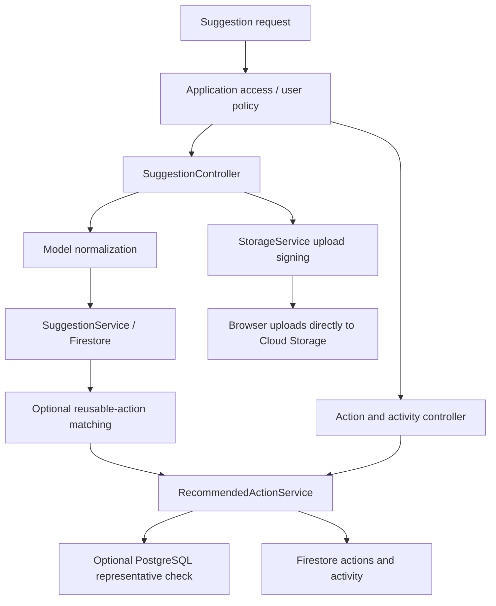

# Suggestions

## What this feature does

Let's imagine a neighbor wants a shady bench beside a bus stop. A suggestion gives that idea a home, with a description, a place, and photos. Next steps and a history of progress can help people turn the idea into something real.

This slice includes base suggestions, JEV-assigned suggestion emojis, attached Recommended Actions, activity, image-upload signing, and integration with the existing [Recommendable Actions catalog](recommendable-actions.md). The [OpenAPI definition](../src/docs/swagger.ts) remains the HTTP contract; the [app](../src/app.ts) mounts the same router at both the public-improvements prefix and its shorter suggestions alias.

## System view

## Responsibilities

- [Suggestion model](../src/models/suggestion.ts): attribution, content/photos, locations, statuses, and normalized create/update fields.
- [Base service](../src/services/suggestionService.ts): Firestore reads, integer allocation, nested merging, and parent/child deletion.
- [Controller](../src/controllers/suggestionController.ts) and [router](../src/routes/suggestionRoutes.ts): filter parsing, route policies, author/staff checks, activity enrichment, and matching after creation.
- [Action model](../src/models/recommendedAction.ts), [action service](../src/services/recommendedActionService.ts), and [action controller](../src/controllers/recommendedActionController.ts): individual next steps and server-attributed activity.
- [Storage service](../src/services/storageService.ts): temporary direct-upload write URLs, not image-byte processing.

## Base suggestion lifecycle

Create validation trims known text and supplies defaults. It is not a strict unknown-property schema validator. Coordinate checks currently verify number types, not full geographic ranges, paired coordinates, or finiteness. A photo URL is a stored reference, not proof of a completed or safe image upload. Missing photo timestamps use the current clock. The server asks JEV to select a relevant emoji from the suggestion summary and details. Individual reads attempt the same assignment when an emoji is absent; JEV errors are logged and do not block creation or reading. Lists do not trigger assignment. The emoji is server-managed and is not accepted through create or update validation.

The service lowercases author emails and allocates automatic integer identifiers in a transaction. Allocation and the subsequent suggestion write are separate, so failed writes can leave gaps. Explicit identifier creation uses read-before-set, not an atomic uniqueness lock. Update uses read/merge/write, not optimistic concurrency protection.

Creation saves the suggestion before attempting catalog matching. Matcher failures are logged without undoing the saved idea; matching may already have created some child actions before a later failure. Updates do not automatically rerun matching. Storing an address does not automatically geocode it.

Lists return base records and omit activity. Detail reads separately attach the newest activity page and pagination metadata; they are not one cross-document snapshot.

## Access and attribution

All suggestion routes use application access. Public reads, creation, and upload signing allow optional user identity. Private update/delete checks compare verified caller emails with the existing stored author or allow canonical staff. Creation attribution is supplied content, not proof of ownership. A missing suggestion can fail the initial mutation authorization check as forbidden before the service is called.

Action mutation routes require staff. Manual activity additionally allows the suggestion author, with actor details taken from verified request identity and timestamps supplied server-side. Comments explain this division; OpenAPI owns the full HTTP contract.

## Next steps and history

A **Recommended Action** belongs to one suggestion; a **Recommendable Action** is reusable catalog content. Optional matcher linkage connects the two without merging their lifecycles.

Action writes transactionally check that the suggestion exists and is not being deleted. Optional representative existence checks occur in PostgreSQL before Firestore writes, not in one cross-store transaction. Deterministic matcher action identity returns an existing action without overwriting it.

A real status transition and its activity entry commit together. Repeating the current status suppresses that transition/log and sets `noOp`; other fields in the same update can still change. Expiration hides actions from default lists without modifying status, and detail reads can still retrieve an expired action. Activity is newest-first with timestamp/document-identity tie-breaking and snapshot-based cursors.

Deletion marks the parent, recursively removes action/log children, then deletes the parent. Cleanup is not one atomic operation; failures may leave partial child cleanup and attempt to reopen the flag for retry. Base update is not guarded by the child service's deletion fence. Photo objects are not removed by suggestion deletion.

## Image upload boundaries

The signer checks declared MIME type, chooses a unique object path, and returns an expiring V4 PUT capability. It does not inspect uploaded content, sanitize SVG, upload bytes, or guarantee public readability; bucket policy and the separate browser upload determine those outcomes. Existing bucket/signing setup stays in the [README](../README.md).

## Evidence and documentation audit

[Recommended Action tests](../tests/recommendedActions.test.ts) cover local action/log validation, expiry, and catalog boundary applicability. [Staff-claim tests](../tests/staffClaims.test.ts) also exercise shared authorization with route/service mocks. They do not constitute full live Firestore/Cloud Storage integration coverage for all suggestion lifecycle races.

The backfill removes path-only controller comments in favor of linked responsibility descriptions. It leaves existing API behavior unchanged. During the audit, the action update's same-status result was checked explicitly: `noOp` describes the status transition, not necessarily every other supplied field. The guide records the implementation's distinction rather than promising a fully unchanged record. No endpoint schema, migration, or permission is introduced here.
